# Entry and Exit Intelligence architecture

Version: architecture 1 / E1 contract 1. This is a research design, not a strategy
approval, broker calendar, trading specification or performance claim. Execution
remains disabled. The source is the existing IAT pipeline, not new indicators.

## Data flow and trust boundaries

```mermaid
flowchart LR
    A[Private source and manifest] --> B[Existing quality / calendar / provenance gates]
    B --> C[Causal closed M1/M5 context]
    C --> D[Source-bound V3 presentation]
    D --> E[Existing isolated SR research interface]
    E --> F[E1 entry research report]
    F --> G[Future E2 exit and risk hypotheses]
    G --> H[Future validated paper-fill model]
    H --> I[Private research evaluation]
```

Live descriptive observations take a separate path to the dashboard. They never
enter E1's synthetic evaluator. The current V3 live-provenance and Exness calendar
restrictions remain unchanged. HISTORICAL_RESEARCH text alone does not qualify
anything: the existing manifest loader, checksum, source/usage rights, independent
approval, dated session/finality and native M1/M5 coverage checks remain mandatory.
E1 has no historical bridge and cannot consume a serialized SR log as eligibility.
A future bridge must invoke the existing loader/preflight and SR manifest path,
bind its exact dataset/configuration hashes and preserve warm-up/evaluation
accounting. It must not call the synthetic public interface with relabeled data.

The five E1 stages are suitability, location, confirmation, qualification and
explanation. Suitability copies upstream observed state, M1/M5 context, liquidity
and restrictions; it adds no ranking or predicates. Location copies the SR zone.
Confirmation copies P/T/C IDs, predicate results and causal availability.
Qualification maps the existing lifecycle without selecting a trade. Explanation
lists canonical support/opposition, missing confirmation, frozen invalidation,
source hashes, age and WAIT. M1/M5 disagreement is an observation, not proof of a
pullback, reversal or entry opportunity.

## Strategy-family specifications

These are future interface requirements, not eight approved strategies. Only SR
rejection is integrated in E1. Other families have no implementation, score,
qualification threshold or activation. All require eligible closed M1/M5,
source-bound canonical IDs, confirmed-before-use levels, explicit provenance and
session quality. “Required” below defines proposed research inputs; independent
rule review must fix versioned predicates before implementation.

| Family | Market conditions / required evidence | Location and confirmation | Contradiction / invalidation | Causal timing / limitations |
|---|---|---|---|---|
| Trend continuation | Existing aligned structure, momentum and existing experimental strategy output | Referenced continuation anchor; use that rule's closed M1 confirmation | Fresh opposing CHoCH, incompatible M5, anchor loss | Confirmed evidence only; no trend persistence assumption; not E1 |
| Pullback rejection | Established directional structure plus explicitly defined retracement evidence | Existing zone or confirmed swing; closed rejection after touch | Structure loss or contrary change; disagreement alone is insufficient | Zone known before touch; future rule must define a pullback; not E1 |
| Breakout | Confirmed level and existing BOS / break observations | Level ID; closed qualifying break under frozen CLOSE/WICK policy | Failed break, opposing structure or level recovery | Event occurrence and availability separate; wick is not close confirmation; not E1 |
| Breakout/retest | Qualified break and later distinct touch of the frozen level | Existing break level and causal closed retest | Retest fails, source is revised or opposing change occurs | Retest must occur after break availability; no backfilled level; not E1 |
| Liquidity sweep reversal | Existing OHLC sweep proxy plus confirmed structure change | Referenced pool/sweep/zone; existing reversal rule confirmation | Opposing CHoCH, sweep thesis loss, incompatible M5 | Pools are OHLC proxies, not hidden orders; not E1 |
| S/R rejection | Existing SR v1 eligible FRESH/TESTED zone, compatible M5 and P/T/C observations | Frozen upstream zone; untouched P, T touch/inside close, immediate closed directional C beyond boundary, no fresh opposing M1 CHoCH | Existing frozen-zone loss, fresh opposing M1 CHoCH; five eligible closes expire | Zone known by T opening; C must immediately follow T; SYNTHETIC_ONLY in E1; no fill at C close |
| BOS/CHoCH transition | Existing confirmed structural event and prior direction | Existing pivot/break ID; versioned continuation/transition confirmation to be reviewed | Failed break, opposing event, source revisions | Use availability, not pivot occurrence; CHoCH is not automatic reversal; not E1 |
| Momentum/volatility expansion | Existing momentum and volatility reports plus structure context | An independently defined source-bound location; expansion alone is insufficient | Deterioration, contrary structure or invalid location | Volatility is separate from direction; thresholds/predicates not yet defined; not E1 |

Strategy adapters should expose family/version, conditions, location references,
confirmation predicates, event/available timestamps, contradictions, invalidation,
missing evidence and limitations. They may not mint price levels, invent causal
history, tune confluence thresholds or grant default strategy selection. Existing
strategy authorship/provenance remains in the original registry and SR docs;
E1's stage layout/state mapping/fill deferral are IAT-specific integration choices.

## Versioned contracts and lifecycle

E1 (`IAT_ENTRY_INTELLIGENCE_V1`) is detailed in ENTRY_INTELLIGENCE_V1.md. It retains
upstream setup identity and the SR v1 rule/policy/configuration hashes. A report
may contain multiple research states and directions; there is no winning entry
selection. WATCHING is reserved and never inferred from arbitrary proximity.
Returned reports remain frozen when later observations arrive. The bounded
session records the hashes it actually produced; verification of EVALUATED JSON
requires that producing session, not just a recomputed checksum or caller label.
This is in-process source binding, not independent provider authentication or
portable signed-log attestation. A future importer needs its own reviewed trust
contract and raw-source replay. Existing DecisionLog v1, Strategy Replay Log v1,
SR log v1 and their dataset accounting are unchanged.

Future entry timing policy versions may compare confirmation-close observations,
next eligible open, retest confirmation, tick confirmation and delayed
confirmation. Each must state the earliest available evidence, admissible side,
quote timestamp/identity, spread/cost inputs and strict event ordering. E1 records
C's availability and requires a later validated side-specific observation plus a
fill/cost model. It produces no hypothetical fill or executable entry price.
The SR source contract supplies no Bid/Ask basis/spread metadata; E1 marks them
unavailable rather than guessing Bid from a research symbol. A future metadata
adapter must bind those declarations to qualified source evidence and exact
quotes; caller labels must not influence qualification or fill prices.

## E2 exit contract — design only

Suggested future `IAT_EXIT_INTELLIGENCE_V1` input: frozen E1 report/hash and setup,
validated hypothetical fill (when available), current causal observations,
source-bound levels, clock/cutoff, session state, price-basis/quote/cost evidence
and a versioned exit policy. Output: trigger status, refs, occurred/available
and observed timestamps, basis, ambiguity, missing inputs, invalidation and
research explanation. No orders, execution prices or automatic risk authorization.

| Exit family | Trigger / required evidence | Observation and causal availability | Basis, ambiguity and costs | Research method |
|---|---|---|---|---|
| Structural stop | Confirmed loss of frozen structural invalidation reference | Eligible close, or separately reviewed tick policy; after level known | Explicit Bid/Ask side; a wick does not identify executable stop order; costs unknown until sourced | Replay first admissible breach, unresolved on missing sequence |
| Structural target | Reach/breach of frozen opposing structure | Quote or close policy fixed before evaluation | Target contact is not a fill; simultaneous stop/target OHLC is unordered; include spread/slippage/fees only if evidenced | Independent exit hypothesis comparison |
| Fixed R:R 1:1/1:2/1:3 | Validated fill and structural risk distance | Freeze ratios before subsequent data | No target without known basis/risk/fill; cost model explicit | Compare versions on identical eligible inputs, never optimize on test outcomes |
| ATR stop/target | Existing eligible ATR and predeclared multiplier | Compute from information available at entry; later updates need a separate policy | Volatility band is hypothetical; unknown intrabar ordering unresolved; sourced costs required | Frozen versus dynamic variants separately versioned |
| Swing trailing | Newly confirmed favorable swing | Update only at pivot availability, never at historical pivot occurrence | Do not retroactively tighten against earlier prices; side/cost model fixed | Causal chronological replay |
| Opposing CHoCH | Existing fresh confirmed opposite structural event | Closed event availability under original break policy | Structure observation is not execution; unknown fill/cost remains unavailable | Link outcome to original setup and event |
| Momentum deterioration | Existing momentum change under a predeclared rule | Eligible close; no threshold invention in E1 | Does not imply an attainable exit; include only evidenced costs | Separate falsifiable rule/version, no score tuning |
| Time exit, including 50 seconds | Validated fill timestamp plus declared duration | **50 seconds needs timestamped ticks or sufficiently granular data**; M1 cannot establish it | Quote at/after deadline under a reviewed timing policy; absent/exact-order ambiguity unresolved | Record deadline, first eligible observation and delay; never claim exact 50-second execution from M1 |
| Original hypothesis invalid | Existing frozen invalidation or verified source withdrawal | First available invalidating observation | Data failure is not evidence of an exit price; freeze unresolved observation | Keep analytical invalidation distinct from price-outcome and fill evaluation |

Every E2 output must retain WAIT/execution=false. If two criteria occur within one
OHLC bar and ordering is unknown, record UNRESOLVED_EVENT_ORDER. Do not assume
best/worst order as fact; any sensitivity model must be explicitly labeled.
Withholding data cannot be used as a successful exit. Transaction costs are not
zero by default. No E2 method is implemented or activated by this PR.

## Future risk and paper interfaces

Risk input must reference frozen setup, known basis/fill/exit hypothesis and
sourced costs. Output may describe structural risk distance, reward distance,
R:R, spread, slippage, commission, volatility, exposure, MFE and MAE with units,
cutoffs and missing reasons. Distances require compatible price bases; conversion,
contract specification and exposure need independently verified metadata. Unknown
inputs stay null. Executable position sizes and risk-based orders are excluded.

Future paper lifecycle: SETUP → CONFIRMATION → HYPOTHETICAL_FILL → MONITORING →
EXIT → EVALUATION. Each transition needs a versioned model, evidence identity,
occurred/available/observed timestamps and explicit unresolved states. Fills must
use Ask to buy / Bid to sell with a validated spread and timing/cost model; exits
must use the appropriate opposite quote side. OHLC alone does not establish a
quote sequence, exact fill or slippage. Blocked intervals and missed observations
must remain visible; never backfill success. Freeze warm-up/evaluation windows,
source hashes and original hypotheses; keep later outcomes separate.

Future metrics: total opportunities, qualified setups, hypothetical fills,
rejections, win rate, net hypothetical P&L, profit factor, drawdown, MFE/MAE,
holding duration, entry/exit efficiency and transaction costs. They require a
qualified dataset and validated fill/cost/exit models, explicit denominators,
unresolved counts, units and out-of-sample protocol. E1 emits **none** of these
performance metrics. Its setup counts are synthetic analytical counts only.

## Next milestone and acceptance requirements

First independently review E1's source binding, state mapping, synthetic examples,
Windows startup regression and bounded resource policy. Before real-data strategy
evaluation, build/review a manifest-gated E1 bridge using the existing SR historical
path and genuinely qualified native same-feed data; preserve private journals,
qualification PENDING and comparisons NOT_RUN until evidence permits the claim.
E2 should begin with one structural invalidation/exit observation interface and
explicit ambiguous-order tests, without fills, profitability or activation. A
separate validated tick/price-basis/cost adapter is required before paper fills
or the 50-second experiment. None of this design authorizes future execution.
