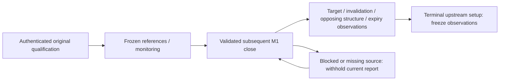

# Exit Intelligence v1 — E2

Model IAT_EXIT_INTELLIGENCE_V1, report/policy version 1. Synthetic research only.
An authentic E1 qualification is **not a position**. Every report retains WAIT,
execution_allowed=false, Exness BLOCKED, DATA_NOT_QUALIFIED, historical validation
PENDING and comparisons NOT_RUN. All entry/exit fills, realized/hypothetical P&L,
holding duration and performance metrics are null. Timer exits are NOT_IMPLEMENTED.
No confidence, expected return, sizing, order, new indicator or strategy selection
is introduced. E1/SR predicates, scores, confluence and calendars are unchanged.

## Review prerequisite and interfaces

[Automated E1 contract review](ENTRY_INTELLIGENCE_V1_INDEPENDENT_REVIEW.md) passed
18 new adversarial tests before E2 implementation, with no verified critical,
high or medium defect. Low limitations remain: in-process rather than portable
source authentication, and bounded full-prefix validation/copy cost. This is not
external human approval or broker qualification.

```python
from iat.intelligence.exit_intelligence import ExitResearchSession, ExitPolicy, validate_exit_report
# Original must be an authentic qualification-cutoff report, not a later snapshot.
research = ExitResearchSession(original_e1, canonical_setup_id,
    entry_source=original_producing_session, policy=ExitPolicy())
report = research.record(current_v3_view, current_typed_context,
    view_inputs=matching_original_view_arguments)
validate_exit_report(report, source=research)
```

The original E1 report must be EVALUATED, SYNTHETIC_RESEARCH, contain the specified
RESEARCH_QUALIFIED setup, and have report cutoff equal to its original qualified
at timestamp. Its producing EntryResearchSession authenticates its exact hash.
A late E1 report, arbitrary serialized log, another session, unknown identity,
unqualified candidate, live/historical label or recomputed checksum cannot grant
eligibility. Invalid construction produces a canonical empty BLOCKED report.

The new additive `EntryResearchSession.fork_at(report)` validates that original,
replays only its trusted SR prefix and verifies the exact original SR log hash.
It returns isolated state, not a copy of the producer's future ledger or future
produced hashes. This is a reviewed prefix adapter, not an arbitrary log importer.
An E1 producer can have advanced since qualification without leaking its future
lifecycle or target references into E2. Original E1 output/log contracts and hashes
are unchanged. The original producer is never advanced by E2.

Current calls require typed synthetic context and the exact declared cutoff
(default: context cutoff). An explicit different as_of, backward time, corrected
prefix, changed source/configuration, same-cutoff conflict or invalid V3 binding
blocks. Live/historical sources reject before the synthetic E1/SR evaluator.
Existing V3, context, session, completeness, chronology and freshness gates run
through E1; no tolerance is widened or provenance relabeled.

## Five stages and exact implemented rules

1. Authenticate the original E1 hypothesis, identity, direction, qualification,
   configuration/policy and SR prefix. No implicit position or fill is created.
2. Freeze original invalidation plus all eligible opposing SR references from the
   verified original SR result's existing `exit_hypothesis.opposing_zones`.
3. Validate the current causal source through an isolated staged E1 session.
4. Observe the four narrowly defined conditions below on subsequent eligible M1
   closes while the original upstream setup was still qualified.
5. Publish immutable explanations, canonical evidence references, source hashes,
   current setup lifecycle and cumulative analytical observations. Choose no exit
   winner, fill or price-outcome classification.

| Condition | Exact rule / causal time |
|---|---|
| Structural invalidation | Reuse SR's original close loss: bullish close < frozen lower − original break_tolerance; bearish close > frozen upper + tolerance. Equality does not breach. Occurrence/availability is that eligible M1 close; first observation is the evaluated cutoff. The reference is not a stop-loss price. |
| Structural target | Default WICK_CONTACT: subsequent M1 high >= frozen target lower for bullish; low <= upper for bearish. The event occurred somewhere in [bar open, bar close], exact occurrence=null, available only at bar close. Separately record whether close cleared the far boundary plus original tolerance. No fill is established. |
| Opposing structure | Consume the unchanged SR current_opposition for the original direction, resolve its typed-context TRANSITION evidence to its existing canonical CHOCH_EVENT ID, and retain both canonical occurrence and contextual evidence references. Source bar interval, confirmation availability, source break policy and original/opposing direction are explicit. No new CHoCH predicate. |
| Setup expiry | Emit only when the original E1/SR setup becomes EXPIRED after five distinct observed eligible closes after C. Blocked/duplicate calls do not increment it. This is not holding duration. Parent SR invalidation precedence is retained if invalidation and expiry threshold coincide. |

A second predeclared policy, CLOSE_BEYOND_REFERENCE, observes bullish close > frozen
target upper + original tolerance, or bearish close < lower − tolerance. Its
occurrence/availability is the close. Policy is frozen in the E2 constructor,
serialized in the report and hashed. There is no mutable per-observation target
mode, new tolerance, ATR, timer, fill or stop policy.

Target candidates must be opposite-kind FRESH/TESTED zones, confirmed by original
qualification, beyond the original confirmation candle close, as already selected
by the original SR interface. Preserve every eligible candidate. Rank by smallest
distance from that confirmation close to the near zone boundary, then canonical
zone ID ascending. Identical prices on different source/timeframe IDs remain
separate candidates. The first is frozen as the observation reference. The
confirmation close is an observed OHLC value, **not** an entry/fill price. No
future movement, newer zones or later entry report can select or revise it. No
candidate means TARGET_UNAVAILABLE throughout this hypothesis; never manufacture
or backfill a reference. This target selection/observation policy is an IAT E2
research choice, not a change to the parent SR strategy's predicates or its
close-based paper-review observations.

## State, chronology and ambiguity



Separate fields describe source_eligibility VALID/BLOCKED, original setup lifecycle
and analytical_states. Multiple analytical observations coexist: MONITORING_HYPOTHESIS,
NO_EXIT_REFERENCE, STRUCTURAL_INVALIDATION_OBSERVED, STRUCTURAL_TARGET_OBSERVED,
OPPOSING_STRUCTURE_OBSERVED, HYPOTHESIS_EXPIRED, UNRESOLVED_EVENT_ORDER and ABSTAINED.
NOT_APPLICABLE is reserved for no applicable observed condition; invalid original
inputs produce BLOCKED. None implies a position or an executed exit.

Target/invalidation/opposing/expiry observations co-available at the same close
are retained separately. A target plus invalidation/opposition/expiry creates an
UNRESOLVED_EVENT_ORDER group. WICK intervals use UNKNOWN_INTRABAR_ORDER: no tick
sequence, target-first or stop-first is asserted. Exact close-based observations
use SIMULTANEOUS_CLOSE_AVAILABILITY, distinct from an unknown intrabar sequence.
They still do not select a hypothetical exit winner. A target followed by a later
invalidating observed close is a sequence of analytical observations, not P&L.

Each event ID hashes original setup identity, condition and canonical event or
candle ID. Fresh CHoCH occurrence identity is separate from contextual evidence
revision IDs. Repeated current snapshots return the same report/hash and do not
double-count evidence, progress lifecycle or re-arm a setup. Event occurrence
interval, source availability and first-observed timestamp are separate. Monitoring
ends on the original upstream setup's terminal state: later targets cannot turn an
expired/invalidated hypothesis into a successful outcome. E1's setup re-arming rules
are unchanged; a new identity needs a separate explicit E2 session.

A genuine source-bound blocked E1/SR observation may advance only the isolated
source clock, not eligible-close age or exit events; the public E2 report is empty
and BLOCKED. Malformed sources do not commit. A skipped/blocked interval is sticky
uncertainty: recovery records current observations only, adds
INTERVENING_EXIT_OBSERVATIONS_NOT_EVALUATED and ABSTAINED, and does not retrospectively
scan missing bars or claim first actual occurrence/order. First *observed* is not
necessarily first *occurred*. The hypothesis assessment then remains unknown
during the unobserved intervals. Snapshot lifecycle labels otherwise mean only
what the unchanged SR invalidation rules establish, not a new suitability score.

## Report and validation contract

Report/model/policy versions, exact policy body, original setup/E1 hash, direction,
qualification cutoff, current cutoff, original lifecycle and eligible-close age,
frozen invalidation/target/candidate references, cumulative observations and their
source IDs/times, support/opposition, missing evidence, ambiguity groups, source
restrictions, original/current E1/V3/context/SR-log/configuration/policy hashes,
explanations, validation status and safety are canonical JSON with SHA-256.
The six null fill/P&L/duration/performance fields are never inferred from OHLC.

EVALUATED source_eligibility=VALID JSON requires its original producing E2 session
and a hash actually produced by it; a checksum alone is insufficient. BLOCKED
reports can validate standalone only as canonical empty diagnostics. A caller
cannot add confidence, fills, levels, execution=true or revise observations and
recompute its way into acceptance. This is in-process source binding, not a
Python sandbox or independent signed portable attestation. Retain qualified raw
sources and replay through reviewed interfaces before any portable import claim.

Sessions are single-threaded and bounded: parent E1 caps 256 accepted snapshots,
10,000 source IDs and 2,048 setups; E2 caps 256 produced report hashes and 256
observations. Revalidation and copied staging retain transactional rollback on
resource/projection failure. There is no silent reset or fallback. Prior returned
reports remain immutable and authenticated after new snapshots. Prefix/correction
failures do not reset original identity, references or lifecycle.

## Live presentation, Windows and historical limits

The existing Entry/Exit panel now separates entry, exit, risk and paper availability.
Current live E2 fields are BLOCKED/UNAVAILABLE, timer NOT_IMPLEMENTED, risk distances
and costs UNAVAILABLE, fill/position lifecycle NOT_IMPLEMENTED and performance
PENDING. No synthetic entry/exit evaluator is invoked on Exness observations.
Existing quote/chart/endpoints, default AI-off and disabled trading checks remain.
The operator has confirmed PR #46 startup and read-only observations; lower-panel
visual verification and this new version's actual terminal operation remain
operator-evidence pending. CI DOM tests are not real Windows browser validation.

Preserve local changes first; no reset, clean, force checkout or PR merge:

```powershell
$root = 'E:\IAT2\IAT3-Live-Test'
git -C $root status --short
git -C $root fetch origin refs/heads/feat/iat-v3-exit-intelligence-v1
git -C $root switch --no-track -c local/iat-v3-e2-review FETCH_HEAD
git -C $root rev-parse HEAD
powershell.exe -NoProfile -File "$root\diagnostics\Start-IATLiveMarketView.ps1" -ValidateOnly
```

Compare HEAD with this draft PR's reported SHA. If the local branch name already
exists, inspect it or choose another fresh name; do not overwrite it. After manually
stopping the old dashboard on port 8768, start the existing read-only observer:

```powershell
powershell.exe -NoProfile -File 'E:\IAT2\IAT3-Live-Test\diagnostics\Start-IATLiveMarketView.ps1'
```

The existing Python 3.11 helper allocates a new private GUID journal, exposes no AI
activation and never starts B.2/B.3 or kills a process. Keep DEMO and terminal/API
trading disabled. The actual PowerShell 5.1 -File startup regression remains in CI.

A future E1/E2 historical bridge must reuse the existing loader, exact source and
normalized hashes, source/feed/usage rights, independent qualification, dated
session exceptions and finality/corrections evidence, native same-feed M1/M5 checks,
and the SR manifest integration. Freeze warm-up/evaluation boundaries and original
qualification references, preserve carried-in setups and observation cutoffs,
replay private raw sources for portable verification, and distinguish internal
M1 aggregation diagnostics from native M5 evidence. Timestamped Bid/Ask, contract
specification, currency and cost evidence are additional prerequisites for fills
or time-exit research. No bridge, historical qualification, private-data upload or
unqualified strategy comparison is performed here.

## Synthetic examples, tests and benchmark

`tests/exit_fixtures.py` independently invents detector OHLC. It is not a native
same-feed dataset. `docs/research_audits/exit-intelligence.synthetic.json` contains
actual deterministic cases and a worked ambiguity with frozen references and both
observations. A target wick and invalidating close in the same synthetic M1 candle
produce two observations and unresolved order, with both fills/P&L still null.
These are not trades, profitability or real-market validation.

```text
python -m unittest discover -s tests -p test_entry_independent_review.py -v
python -m unittest discover -s tests -p test_exit_intelligence.py -v
python -m unittest discover -s tests -v
python tests/benchmark_exit_intelligence.py
```

Python 3.11.9 tracing-enabled prebuilt-input benchmark: source binding 372.126 ms;
E1 same current input 1,256.809 ms / 1,577,013 peak traced bytes; E2 original freeze
40.740 ms / 440,188 bytes; E2 current evaluation 1,313.193 ms / 1,643,740 bytes.
Three revalidated duplicates: 1,302.230 / 1,312.411 / 1,344.820 ms, with peak traced
allocations up to 1,660,802 bytes. One event and two produced hashes remain.
This isolates E2 overhead against E1 on identical synthetic current inputs, not the
old different-fixture E1 timing alone. Tracing adds overhead; context generation,
RSS, maximum-size sessions, Windows/MT5/network latency and market validation are
not measured. No performance or latency SLA is inferred. Full matrix test results
are recorded in the draft PR; no validation claim is made without completed logs.

Focused E1 review + E2 + inherited E1/live-view validation: **127 tests passed** on
Python 3.11.9 (77.559 s) and 3.12.14 (68.678 s), including 18 review and 40 E2 cases.
The five committed metadata SHA-256 checks pass with zero restored files. Final
full-suite counts and completed Linux/Windows job logs are linked in the draft PR.
