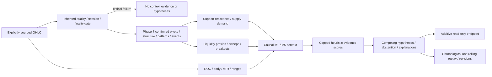

# Market Context & Confluence Engine v1 — Phase 8

AI Reasons. Code Protects. Evidence Validates. Evolution Improves.

Base: Phase 7 `feat/iat2-market-intelligence-v1`, commit
`983e3b600a45386d26d0c3ffc3af4d5e9d39767d`. All analyses remain
READ_ONLY_SHADOW, signal WAIT, execution_allowed=false. Zone geometry, momentum
and heuristic scores neither establish a trading edge nor grant execution.
The existing Exness profile remains BLOCKED; no actual terminal was tested.

## Architecture and versioned outputs



The modules under `iat/intelligence` are deterministic and broker-free:
`support_resistance`, `supply_demand`, `liquidity`, `momentum`, `volatility`,
`context`, `confluence`, `hypotheses`, `context_models`, `context_evidence`.
`iat/context_api.py` is the thin read-only transport boundary. No order/account/
credential/terminal-initialization interface is added. Phase 7 modules and their
existing endpoints are preserved.

`ContextConfig` and `ContextReport` are typed frozen dataclasses with explicit
version 1. Report model is IAT_MARKET_CONTEXT_V1. Report/config JSON contracts:

- `config/market-context-config-v1.schema.json`.
- `config/market-context-report-v1.schema.json` (pure engine report).
- `config/examples/market-context-v1.synthetic.json` (synthetic configuration only).

`ContextConfig.from_dict` requires version and rejects unknown fields, invalid
numeric types, booleans as numbers, nonfinite values and conflicting limits.
The report includes the complete configuration, its canonical JSON SHA-256 and
Phase 7's configuration SHA-256. Default Phase 7 settings are unchanged; trusted
callers may supply a reviewed IntelligenceConfig separately.

Reports separate observed_facts (candle measurements and calculated numeric
conditions), interpretations (zones/structure/events and a canonical source
registry), and hypotheses (tentative scenarios with assumptions/invalidation).
Every hypothesis contains supporting/opposing references, relevant current zones,
M1/M5 context, quality limitations, heuristic score, generation time and versions.
All six scenarios are reported, including unmet structural preconditions; only
confluence.selected_hypothesis denotes the uniquely eligible candidate under
configured research rules. NO_CLEAR_DIRECTIONAL_HYPOTHESIS is an honest outcome.
No field is an executable recommendation or probability of profit.

## Eligibility and time semantics

`analyze_context(symbol, m1_rows, m5_rows, as_of, ...)` consumes causal prefixes and
reuses Phase 7's complete validation. No function in the pure engine reads wall
time or connects to a broker. Aware timestamps normalize to UTC. At most 5,000
rows per supplied frame; at least three rows are required. Supplied empty history
is incomplete; a None frame is explicitly unavailable.

Malformed OHLC, duplicates, ordering errors, unclosed/future/misaligned bars,
staleness, unexpected gaps, uncertain finality, partial/restricted/unknown phases,
expired/blocked coverage or unsafe arithmetic block derivation. A critical failure
in EITHER supplied frame clears facts/interpretations/evidence/hypotheses and
scores. Missing structure or indicator warm-up instead produces explicit
limitations and abstention. A score cannot override any critical failure.

Offline SYNTHETIC_RESEARCH and HISTORICAL_RESEARCH retain their explicit provenance
and limitations. Without a calendar they use strict continuity, not broker
assurance. If supplied, a calendar is ALWAYS enforced, even in synthetic mode.
VALIDATED_LIVE requires verified session coverage/finality. Unsupported provenance
is redacted to UNVERIFIED by Phase 7 and blocked. A historical provenance label is
an operator declaration, not proof of independent dataset authenticity.

`context_at` selects chronological closed prefixes just like Phase 7: it stops at
the first unfinished/future candle, without inspecting later observations. It
assumes ordered replay input; the selected prefix still passes full validation.
The direct `analyze_context` entry point rejects unclosed rows instead of trimming
a claimed causal prefix. Do not sort invalid observed data into apparent success.

At each M1 close T, only eligible M5 candles whose closes are ≤T are available.
Pivot levels are available at their confirmation close, never their earlier
occurrence. Source events record occurrence as their source candle OPEN, not an
invented exact intrabar tick time; available_at is the confirming candle CLOSE.
Do not infer wick timing or order-flow chronology from OHLC.

## Support and resistance

Only Phase 7 CONFIRMED pivots participate. Same-kind pivots are processed in
chronological order and assigned to the first cluster whose FIRST pivot anchor
is within cluster_tolerance. The anchor stays fixed; tolerance is absolute price
units, not broker points. Candidate pivots cannot establish a zone.

A zone becomes knowable when minimum_touches confirmed pivots exist. Its bounds
are min/max of these INITIAL pivots, expanded by zone_half_width (lower bound
floored at zero). Bounds are fixed at formation; later pivots never widen earlier
history. The zone exposes origin, confirmation, supporting canonical pivots,
historical touch confirmation times, width via upper−lower, status, retests,
broken/invalidation timestamps and reason codes.

Retests start AFTER formation. An overlapping candle episode counts once until
price leaves and returns; consecutive overlapping bars are not separate visits.
A support close below lower−break_tolerance or resistance close above
upper+break_tolerance marks BROKEN. A later retest closing on the broken side is
ROLE_REVERSAL_CANDIDATE. A later reclaim across the far boundary invalidates that
broken-role interpretation. INVALIDATED is terminal within the supplied history.
Without a break/retest the zone is FRESH; otherwise TESTED. These labels are
potential roles, not guarantees of price reversal or durable order-book levels.

Only noninvalidated/nonbroken zones near the CURRENT close (inside bounds plus
cluster_tolerance) can contribute confluence. Potential role reversal flips its
heuristic role explicitly. Far-away/inactive zones remain visible but do not vote.

## Supply and demand

At each potential departure candle i:

1. The immediately preceding base_bars form the base; the range_period candles
   BEFORE that base form its baseline, excluding both base and departure.
2. Mean base range ≤ baseline mean range × base_range_ratio, and total base
   high−low width ≤ baseline mean range × base_width_ratio.
3. Departure body/range ≥ departure_body_ratio, with positive range.
4. A bullish close exceeds the base upper edge by STRICTLY more than
   baseline mean range × departure_range_multiple → DEMAND candidate. Mirror for
   bearish close below the base → SUPPLY candidate.
5. Optional departure_atr_multiple adds a maximum threshold using the preceding
   arithmetic ATR; insufficient ATR warm-up abstains.

Availability is the departure candle CLOSE. The base's origin timestamp never
backdates that knowledge. Prior structure is computed using pivots confirmed
before the departure candle opened. Bounds are the actual base high/low range;
no artificial prices or institutional participation are claimed. Retests count
separate postformation episodes. A qualifying close through the far edge makes
INVALIDATED permanently; these candidates do not silently become opposite zones.

## Liquidity concentration and events

A confirmed swing is a SWING_HIGHS/LOWS potential pool. A fixed-anchor cluster of
minimum_touches confirmed highs/lows forms EQUAL_HIGHS/LOWS and a repeated-range
boundary proxy. Pool level is the initial supporting pivots' arithmetic mean and
stays fixed; formation time is their latest confirmation close. This is NOT
actual stops, hidden orders, traded volume or institutional liquidity.

Starting with candles AFTER pool confirmation:

| Observation | Policy |
|---|---|
| Potential pool | Confirmed swing or equal-level cluster; no implied direction |
| LEVEL_PENETRATION | Wick/close exceeds level by break_tolerance |
| CONFIRMED_SWEEP | Wick penetrates and the SAME finalized candle closes strictly back inside by break_tolerance |
| SUSTAINED_BREAKOUT | breakout_closes consecutive finalized closes beyond level+tolerance (mirrored for lows) |
| AMBIGUOUS_EVENT | Boundary close without clear rejection, or a prior close-through that returns before sustained confirmation |

A first close-through alone remains penetration, not a sustained breakout. It
cannot later be rewritten as an earlier wick sweep. Sweep/ambiguous/breakout
outcomes terminate that pool's event sequence in the supplied history; no
undocumented re-arming. Multiple distinct pools may observe the same candle.
Sweeps stay NEUTRAL in confluence: a sweep is not automatically a reversal.
Only a CURRENT sustained breakout contributes a directional liquidity vote.
All other geometry and historical events remain visible without active votes.

## Momentum and volatility formulas

For ROC period n:

- ROC(t) = C(t)/C(t−n) − 1 (fraction, not percentage).
- Previous ROC = C(t−1)/C(t−n−1) − 1; acceleration = ROC(t)−previous ROC.
- Body momentum = mean((C−O)/(H−L)) over the last n candles; zero-range bar
  contributes zero. Complete ROC/acceleration warm-up requires n+2 candles.
- POSITIVE_MOMENTUM requires ROC > momentum_threshold AND body momentum >0.
  NEGATIVE_MOMENTUM mirrors both signs; otherwise WEAK_OR_MIXED_MOMENTUM.
- ACCELERATING/DECELERATING compares |ROC(t)|−|previous ROC| against
  acceleration_threshold; otherwise STABLE_OR_MIXED. Signed acceleration is also
  exposed; magnitude change avoids calling stronger negative momentum slowing.

ATR is arithmetic mean true range over atr_period candles, with one additional
preceding close: TR=max(H−L, |H−previous C|, |L−previous C|). Price jumps contribute
to true range; unexpected timestamp gaps are rejected upstream.

Recent range mean uses last range_period ranges; preceding mean uses the
DISJOINT previous range_period ranges. Relative volatility = recent/preceding.
Above volatility_high → HIGH_VOLATILITY / VOLATILITY_EXPANSION; below
volatility_low → LOW_VOLATILITY / VOLATILITY_CONTRACTION; between inclusive bounds
→ NORMAL_VOLATILITY / STABLE_VOLATILITY. ATR needs full warm-up, both range
windows must exist, and zero preceding mean returns null/INSUFFICIENT_EVIDENCE.
Invalid zero/nonfinite prices are rejected upstream, never used as denominators.
Nonfinite derived arithmetic fails closed. Momentum is evidence, not an entry.

## M1/M5 context and opposing CHoCH

Phase 7 structure/alignment remains unchanged. Context exposes its label and
both frame structures/as-of times. It identifies bullish/bearish alignment,
COUNTERTREND_TRANSITION, STRUCTURAL_CONFLICT, SIDEWAYS_OR_RANGING,
CONFLICTING_EVIDENCE, INSUFFICIENT_DATA or BLOCKED_DATA_QUALITY. Missing/UNKNOWN
structure prevents an eligible directional scenario. Momentum/volatility warm-up
limitations are also explicit, per timeframe.

Phase 7 gives matching bullish/bearish structures precedence in its alignment
label. Phase 8 therefore inspects CURRENT M1 CHoCH events independently, requiring
the event's confirmation to equal the frame's latest data_as_of. An opposing event
is retained as opposite-direction evidence and appears in the aligned
continuation hypothesis's contradictory_evidence even if Phase 7 still says
BULLISH_ALIGNMENT or BEARISH_ALIGNMENT. It is never hidden by that label.

Both cases have regressions using genuine synthetic OHLC through Phase 7,
not injected labels. The synthetic sequence confirms a further HH (or LL) on
the same bar that breaks a previously confirmed opposite level: matching swing
structure and opposing current CHoCH can legitimately coexist.

## Explainable confluence and competing hypotheses

Weights are configured heuristics, NOT statistical independence, predictive
accuracy or probabilities of profit. No probability, order size or trade side is
produced. Each evidence record has an absolute canonical identity, timeframe,
category, direction, occurrence/availability, references, details and reason codes.

For each direction, cap contributions to ONE weight per (timeframe, bucket,
direction). SUPPORT_RESISTANCE and SUPPLY_DEMAND share PRICE_ZONE, preventing
correlated zones from accumulating independent votes. Multiple pattern labels,
multiple broken levels or duplicate records cannot inflate a category. A
lexicographic canonical-ID order chooses the counted representative; the rest
remain visible with zero effective weight and a cap reason.

| Bucket | Default weight per M1/M5 and direction |
|---|---:|
| STRUCTURE | 2 |
| TRANSITION (fresh CHoCH) | 2 |
| PRICE_ZONE (combined SR/SD) | 1 |
| LIQUIDITY (current sustained breakout only) | 1 |
| MOMENTUM (ROC + body agreement) | 1 |
| CANDLE (contextual/engulfing/star/momentum labels; shape-only pins do not vote) | 0.5 |
| VOLATILITY | 0; risk/limitation evidence |

BULLISH/BEARISH/RANGING scores are sums of those effective weights. Opposite
hypothesis evidence is always retained. Minimum score defaults to 3, required
margin over the next score to 1, material opposition threshold to 3. Unknown
structure, missing frames, indicator warm-up, timeframe conflict, insufficient
support/margin, material opposition, fresh opposing M1 CHoCH, or high volatility
cause explicit abstention. Opposing CHoCH is assessed against directional M5
structure when available (otherwise the score leader), so changing score
weights cannot hide that higher-timeframe contradiction. No "high confidence"
claim follows from a score.

Candidates: BULLISH/BEARISH_CONTINUATION_POSSIBILITY require matching M5 direction;
BULLISH/BEARISH_STRUCTURAL_TRANSITION require a fresh corresponding CHoCH;
RANGE_CONTINUATION requires both frames RANGING. All are tentative and include
unmet preconditions as limitations. Only one eligible leading-direction candidate
may be selected; otherwise NO_CLEAR_DIRECTIONAL_HYPOTHESIS. Continuation and
transition can compete; no arbitrary tie-break creates certainty. Every scenario
states independent data/session eligibility, structural contradictions and zone
invalidation as conditions requiring revision. Execution remains false regardless.

## Canonical identity, rolling windows and replay

Phase 7 IDs such as M1:C:12 and M1:P:HIGH:8 are WINDOW-RELATIVE. They are translated
before Phase 8 aggregation; they are never replay ledger keys or score keys.

- Candle identity hashes symbol, timeframe, UTC open and normalized OHLC content.
- Confirmed pivot identity hashes symbol/timeframe, kind, occurrence,
  confirmation and price. Local index and local pivot ID are excluded.
- Pool/zone identities include absolute formation evidence and fixed geometry.
- Context evidence identity includes canonical references, occurrence/availability,
  direction, definition details and BOTH configuration fingerprints.
- Repeated structure evidence uses actual latest pivot confirmation, not every
  later snapshot timestamp. New current momentum/zone tests have their own
  timestamped observations. Corrected OHLC or changed definitions are new evidence.

The source registry resolves canonical references and their UTC availability.
Phase 8's serialized interpretations translate Phase 7 pattern/structure refs too.
Same observations shifted to different window indexes remain the same evidence;
different observations reusing a local Phase 7 ID remain distinct. Initial zone
anchors and available predecessor pivots may change when old history leaves the
window; those changed bounded-history interpretations are not claimed to be one
eternal globally tracked zone. Durable broker/instrument state remains future work.

`replay_context(..., window=None)` yields each M1 close's report plus new_evidence,
unique_evidence_count, hypothesis_revisions and withdrawn_hypotheses. With a
rolling window (3–5000 bars per frame), canonical IDs—not local indices—govern
the ledger. Unique counts are historical audit counts, NEVER accumulated votes.
Every confluence score is recomputed from ONLY that snapshot. Revisions include
changed support/opposition, context/as-of, assumptions and zones; generation time
alone is excluded. A blocked report can withdraw earlier hypotheses; past reports
are never backfilled with future outcomes.

`ContextStream` reuses Phase 7's strict append, late-data, duplicate and clock
protections and supports snapshot(as_of, window=...). Prefix-only historical
results, chronological replay and independently fed streams are tested equal,
including rolling windows. Future price mutation and unfinished M5 exclusion
are tested. Replay is a bounded causal research reference, not a P&L backtest or
optimized live state engine; large full-history replay is computationally costly.

## Configuration

All prices/tolerances are absolute symbol units. Thresholds are heuristics,
not broker-certified calibration. No parameter loosens the session/quality gate.

| Field | Default |
|---|---:|
| version | 1 |
| cluster_tolerance / zone_half_width / minimum_touches | 0.1 / 0.05 / 2 |
| break_tolerance | 0.01 |
| base_bars / base_range_ratio / base_width_ratio | 2 / 0.8 / 2 |
| departure_range_multiple / departure_atr_multiple / departure_body_ratio | 1.5 / 0 / 0.6 |
| roc_period / atr_period / range_period | 5 / 14 / 5 |
| momentum_threshold / acceleration_threshold | 0.001 / 0.0001 |
| volatility_high / volatility_low | 1.5 / 0.67 |
| breakout_closes | 2 |
| minimum_score / contradiction_limit / minimum_margin | 3 / 3 / 1 |
| structure / zone / liquidity / momentum / candle weights | 2 / 1 / 1 / 1 / 0.5 |

Window integers are 2–100; ratios and ordered volatility thresholds are checked.
Weights are nonnegative and bounded to 100. Absolute thresholds are finite and
nonnegative; zone width, score/margin and contradiction thresholds must be
positive. Optional ATR departure normalization defaults off and requires its own
warm-up when enabled. Unknown JSON fields and unsupported versions fail.

## Additive HTTP API and compatibility

`GET /research/v1/context?symbol=XAUUSD` accepts one exact symbol query. No
query parameter may choose synthetic provenance, override thresholds/weights,
access credentials or enable execution. Thresholds come from trusted
create_app(context_config=ContextConfig(...), intelligence_config=...) arguments.

The adapter fetches 100 position-1 closed candles independently for M1/M5 using
the existing provider and calendar, then resamples the guarded UTC clock and
revalidates BOTH frames. Analysis uses latest M1 close, with only M5 candles
closed by that time. HTTP success adds requested_at_utc and optional redacted
session_v2 to the pure schema. No account/server/provider exception details are
serialized. Success 200 may still honestly abstain. Invalid query is 400;
unavailable/invalid provider/session/data/clock gives 503. Preflight errors use a
minimal versioned BLOCKED envelope with empty evidence/hypotheses and reason codes.
All JSON outcomes retain WAIT, false, READ_ONLY_SHADOW and Cache-Control:no-store.

`/analyze` and `/research/v1/intelligence` keep their existing behavior. Phase 7,
Session Engine v2, provider, quality engine and Exness profile files are unchanged.
Tests exercise both old routes and all inherited tests. The new research endpoint
cannot unblock the Exness calendar or claim actual-terminal validation.

## Synthetic worked example and chronological log

This uses SYNTHETIC prices, not broker observations or verified XAUUSD levels.
The source label is an explicit research declaration, not authenticity proof.

```python
from datetime import datetime, timedelta, timezone
import json
from iat.intelligence import IntelligenceConfig
from iat.intelligence.context_models import ContextConfig
from iat.intelligence.context import context_at, replay_context

start = datetime(2026, 11, 12, 8, tzinfo=timezone.utc)
synthetic_prices = [100,104,100,96,100,107,103,99,103,110,106,102,
                    106,113,109,105,109,116,112,108,112,118,94]
synthetic_rows = [dict(timestamp=(start+timedelta(minutes=i)).isoformat(),
                       open=p, high=p+0.5, low=p-0.5, close=p)
                  for i,p in enumerate(synthetic_prices)]
context_config = ContextConfig(roc_period=2, atr_period=2, range_period=2)
phase7_config = IntelligenceConfig(left_strength=1, right_strength=1)
report = context_at('SYNTHETIC', synthetic_rows, None,
    start+timedelta(minutes=len(synthetic_rows)), config=context_config,
    intelligence_config=phase7_config, provenance='SYNTHETIC_RESEARCH')
assert report.signal == 'WAIT' and report.execution_allowed is False
assert report.confluence['selected_hypothesis'] == 'NO_CLEAR_DIRECTIONAL_HYPOTHESIS'
# Missing M5 is explicit; no fabricated higher-timeframe direction.
log = list(replay_context('SYNTHETIC', synthetic_rows, None, window=18,
    config=context_config, intelligence_config=phase7_config))
# A chronological evidence log, not a profitability backtest.
with open('synthetic-context-replay.jsonl', 'x', encoding='utf-8') as output:
    for observation in log:
        output.write(json.dumps(observation, allow_nan=False)+'\n')
```

Use exclusive new log names; never treat an interrupted JSONL write as completed
broker evidence. No local terminal or account is needed for this synthetic example.
For software checks: install requirements-dev.txt into the existing environment,
then run `python -m unittest discover -s tests -v`. jsonschema remains test-only.

## Remaining limitations and next milestone

OHLC does not reveal hidden liquidity, exact wick paths or institutional intent.
Zone/threshold/score policies require independent review and instrument-scale
research; the numbers are not calibrated confidence or demonstrated performance.
Scoring caps reduce obvious duplication but do not establish statistical
independence between evidence categories or timeframes. Rolling history changes
which predecessors/anchors are available; the log makes bounded-history revisions
visible without asserting durable global levels. Full prefix replay is costly
and intentionally recomputes observations; history limits are not latency guarantees.

Next: independent review of Phase 8 definitions, evidence identity, failure behavior
and replay stability on separately curated historical datasets. Separately resolve
broker schedule/holiday/maintenance/finality holds before actual read-only Exness
validation. No order/risk-sizing/execution component, calendar approval, account
access, profitability testing or PR merge is part of this delivery.

## Recorded software verification

The complete local suite passes on Python **3.11.9** and **3.12.14**:
**450 passed, 0 failed**, including **373 inherited** and **77 new** tests.
Coverage includes zones/confirmation/retests/invalidation, sweep versus sustained
breakout, ROC/ATR/threshold mathematics, confluence caps/opposition/abstention,
report schemas, canonical reference resolution, both requested aligned-label
CHoCH regressions, rolling-window identity/counts, streaming/prefix/replay
agreement, unfinished M5, malformed/stale/gapped/partial data, provider failures,
clock changes, compatibility and execution-disabled/Exness-blocked behavior.

The documented synthetic example was executed and produced **23 chronological
schema-valid JSONL reports**. These are synthetic software observations, not real
broker validation. GitHub Actions runs the same complete suite on Linux and
Windows with Python 3.11.9/3.12 plus inherited Windows fail-closed smoke checks.
Refer to the draft PR's latest commit checks for the final CI result; a prior
successful run never certifies a later revision.

## Offline dataset and DecisionLog validation

See [Historical analytical replay](HISTORICAL_REPLAY_VALIDATION.md) for the
additive stable CHoCH event_id, contextual revision counts, strict local XAUUSD
dataset manifest and causal DecisionLog v1. Existing execution/calendar holds remain.
