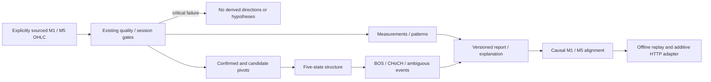

# Market Intelligence Engine v1

AI Reasons. Code Protects. Evidence Validates. Evolution Improves.

Phase 7 extends Phase 6 at `517fd89b4c726f9d4ca15f0d86f7430c70af7feb`.
It describes eligible OHLC observations and deterministic interpretations, not a
trading recommendation, calibrated probability, or demonstrated profitable edge.
Every report is READ_ONLY_SHADOW, signal WAIT, execution_allowed=false. The
Exness profile remains blocked; no schedule/finality evidence is created here.

## Architecture and contracts



`iat/intelligence` contains immutable dataclasses, measurements, patterns,
swings, structure, structural breaks, alignment, deterministic explanations,
and orchestration. Only `api.py` uses the existing provider adapter. The pure
modules have no terminal/account/credential/order APIs. They reuse the existing
Candle model, quality checks, SessionCalendar/v2 compiler and finality contract.

`IntelligenceConfig` is a frozen, validated, version-1 configuration. Load a
reviewed JSON dictionary with `IntelligenceConfig.from_dict`: version is
mandatory, unknown keys and invalid types/nonfinite thresholds fail. Omitted
known parameters take explicit documented defaults. The report includes the
complete resolved configuration and canonical JSON SHA-256. The
[config schema](../config/intelligence-config-v1.schema.json) is structural;
runtime validation additionally requires doji_ratio < small_body_ratio.
No configuration parameter grants execution or calendar approval.

[Report schema](../config/intelligence-report-v1.schema.json) describes the pure
engine payload, version 1, model IAT_MARKET_INTELLIGENCE_V1. Reports contain
symbol, UTC analysis timestamp, M1_M5 identity, provenance, quality, per-frame
reports, alignment, observed facts, derived interpretations, tentative research
hypotheses, evidence, contradictions, reason codes, missing evidence,
ambiguities and explanation. It never supplies an executable order/BUY/SELL.

Per-frame evidence IDs are report/window-relative: `M1:C:12`,
`M1:P:HIGH:8`, and event IDs referencing pivot/type/break index. Candle references
include index, opening timestamp and close-time availability; pivot references
include occurrence and confirmation separately. Do not deduplicate events across
independently shifted 100-bar API windows by these local IDs. Replay fixes its
history origin. Cross-window durable state is future research, not inferred.

## Quality and provenance

`analyze_intelligence(symbol, m1_rows, m5_rows, as_of, ...)` accepts causal prefixes
of timezone-aware OHLC mappings and returns a typed report. `as_of` is explicit;
no pure analytical function reads wall-clock time. Rows are normalized to UTC.
Minimum history is three rows per supplied frame, maximum 5,000. No frames is
blocked; a `None` frame is explicitly unavailable and alignment is insufficient.
An empty supplied list is incomplete data, not an assertion of valid absence.

Provenance is SYNTHETIC_RESEARCH (default), HISTORICAL_RESEARCH (operator assertion,
not authenticated certification), or VALIDATED_LIVE. Offline calendar-free
research is explicitly labeled, requires strict candle continuity and records
SESSION_NOT_CHECKED. It must never be presented as broker validation. Calendar
arguments are always enforced, even for synthetic research. VALIDATED_LIVE
requires a verified calendar and finality evidence; it is the API's only mode.

Existing validation rejects malformed/nonpositive/nonfinite/inconsistent OHLC,
duplicate/out-of-order/naive/misaligned timestamps, unclosed/future bars, stale
history, unexpected gaps, unknown/restricted/partial sessions, unverified
finality, expired/blocked calendars and unsafe derived arithmetic. No fill,
repair, rounding, sorting or filtering a bad observed bar into ordinary success.
Legitimate verified session closures use the existing session-aware gap rules.
Any critical failure in either supplied frame clears ALL frames and hypotheses
and yields BLOCKED_DATA_QUALITY. Missing history/structural warm-up is reported;
it never becomes an assumed direction.

The inherited two-bar freshness tolerance remains. Offline historical callers
supply the historical evaluation timestamp; no historical replay claims current
freshness. Session configurations still require coverage/expiry valid at that
evaluation time. Do not relabel current blocked broker data as synthetic in a
live path; the HTTP endpoint has no research-provenance bypass.

## Candle formulas and pattern policies

For open O, high H, low L, close C:

- Range R = H − L; body B = |C − O|.
- Upper wick U = H − max(O,C); lower wick D = min(O,C) − L.
- Body/range = B/R; wick/body = U/B and D/B.
- Range ≤ epsilon is zero range: ratios that divide by zero are null; DOJI only.
- DOJI if B ≤ doji_ratio × R + epsilon; otherwise body sign defines color.
- Prior range mean is the arithmetic mean of up to range_window PRECEDING
  ranges, excluding the classified candle. Relative range = R/prior mean,
  null if no positive baseline. Warm-up count is always exposed.
- Prior trend is UP/DOWN only if trend_window preceding closes strictly increase/
  decrease by more than epsilon each step. Otherwise UNKNOWN. Color alone does
  not establish structure.

Threshold comparisons include absolute epsilon except strict body expansion and
strict configured structural breaks. All applicable pattern labels coexist;
there is no hidden priority or reversal score.

| Label | Objective rule |
|---|---|
| BULLISH/BEARISH_ENGULFING | Opposite strict body colors, current real body contains previous real body within epsilon, strictly greater body size |
| BULLISH_PIN_BAR | Non-doji B ≤ small_body_ratio R; D ≥ long_wick_body B; U ≤ short_wick_range R |
| BEARISH_PIN_BAR | Mirrored upper-long/lower-short geometry |
| HAMMER / HANGING_MAN | Bullish-pin geometry with DOWN / UP preceding context |
| INVERTED_HAMMER / SHOOTING_STAR | Bearish-pin geometry with DOWN / UP preceding context |
| DOJI | Rule above, including zero-range candles |
| DRAGONFLY_DOJI | Doji, U ≤ short_wick_range R, D ≥ (1−doji_ratio−short_wick_range)R |
| GRAVESTONE_DOJI | Mirrored dragonfly |
| MORNING_STAR | First bearish body ≥ momentum_body_ratio of its own range; second body ≤ small_body_ratio of first body; third bullish close recovers star_recovery fraction of first body |
| EVENING_STAR | Mirrored morning star |
| INSIDE_BAR | Current H ≤ previous H and L ≥ previous L (tolerance allowed; equal range is inside) |
| OUTSIDE_BAR | Current contains previous range, with at least one strict extension |
| BULLISH/BEARISH_MOMENTUM_CANDLE | Matching non-doji body color, B ≥ momentum_body_ratio R, relative range ≥ momentum_relative_range, complete preceding range_window warm-up |

Star rules do not require price gaps (continuous-session OHLC research policy).
Their interpretation is THREE_CANDLE_CANDIDATE_NO_GAP_REQUIRED. Pin bars are
SHAPE_ONLY; contextual hammer/star/hanging names are CONTEXTUAL_CANDIDATE, never
proof of a reversal. Missing trend context suppresses contextual labels without
suppressing the underlying pin shape. Every label references all used candles
and is detected only at the last candle's close. No future candle is consulted.

## Confirmed swings and structure

A high pivot at i strictly exceeds every left_strength preceding high by more
than equal_tolerance. No right_strength following high may exceed it by more
than that tolerance. Low pivots mirror this. This is a **leftmost plateau**
policy: right ties are allowed, left ties suppress later plateau candidates.
Absolute tolerance is in symbol price units, not broker points. A flat window
produces no artificial pivots. A candle may objectively be both a high and low
pivot; labels coexist and do not imply hidden intrabar chronology.

Candidates pass the observed portion of the right window but lack enough right
candles. They have null confirmation metadata, status CANDIDATE and relation
UNCLASSIFIED; they never establish structure. Confirmed pivots record candle
occurrence at its OPEN and availability at CLOSE of candle i+right_strength.
Future invalidation of a candidate never alters an already emitted report.
Supporting candle references cover the entire observed left/right window.

Compare each confirmed high to the preceding confirmed high: HH/LH/EH. Compare
lows: HL/LL/EL. Equality uses absolute equal_tolerance. The first of either kind
is UNCLASSIFIED. Occurrence and confirmation order agree for fixed strengths.

Structure requires at least TWO confirmed highs AND TWO confirmed lows. The
latest high relation and latest low relation define:

| Relations | Structure |
|---|---|
| HH + HL | BULLISH |
| LH + LL | BEARISH |
| EH + EL | RANGING |
| Other sufficient pairs | TRANSITIONAL, with contradictory relations exposed |
| Too few confirmed pivots | UNKNOWN / STRUCTURE_INSUFFICIENT_PIVOTS |

These are deterministic sequence labels, not a trend certainty. Old pivots can
persist within the caller's bounded history; there is no inferred confidence
from age or an automatic directional override based on a candle's color.

## BOS, CHoCH and wick observations

Only confirmed levels available **before the break candle opens** qualify.
A pivot confirmed at candle i's close cannot explain a break on that same candle.
For high levels distance is price−level; for lows it is level−price. A qualifying
break strictly exceeds max(min_break_distance, ATR×atr_multiplier)+epsilon.
CLOSE is default; WICK uses the high/low and is explicitly tagged
WICK_POLICY_NOT_CLOSE_CONFIRMATION. WICK is a configurable research definition,
not an execution or provider-quality relaxation.

ATR is arithmetic mean true range over atr_period PRECEDING bars, requiring one
additional preceding close; TR=max(H−L, |H−previous C|, |L−previous C|). The current
break candle never inflates its own threshold. When optional ATR is enabled and
warm-up is incomplete, break detection abstains. The default multiplier is zero.

A qualifying break in established structure's direction is bullish/bearish BOS;
a qualifying opposite break is bullish/bearish CHoCH (possible transition only).
UNKNOWN/RANGING/TRANSITIONAL prior structure yields AMBIGUOUS_STRUCTURAL_EVENT,
never an invented CHoCH. Prior direction is recomputed only from pivots available
at that break time, not the final report's structure.

Under CLOSE policy, qualifying wick penetration without close confirmation emits
WICK_PENETRATION once per level. A close strictly back inside additionally emits
POTENTIAL_LIQUIDITY_SWEEP: an OHLC rejection proxy, not actual stops/order flow or
an automatic reversal. A consumed break that later closes strictly inside emits
FAILED_STRUCTURAL_BREAK once, only at that later candle's close. No future failure
is backfilled into the original event.

Each confirmed high/low remains a level until its first qualifying break; this
consumes it permanently within the supplied history. Wick-only observation does
not consume it. There is **no re-arming**; a new confirmed pivot is a new level.
Multiple distinct levels can break on one bar; no intrabar ordering is claimed.
Events include level, pivot, prior direction, break candle, close availability,
distance, threshold, confirmation policy, evidence and reason codes.

## M1/M5 and anti-look-ahead contract

Analyze each frame independently. `analyze_at` selects a chronological closed
prefix; it stops at the first unfinished/future bar and never reads later rows.
The source must be chronological; the selected prefix still passes all quality
checks. Use the strict direct API `analyze_intelligence` to validate a complete
claimed causal prefix; it rejects future/unclosed rows instead of trimming them.
An unordered batch is not a supported replay source; do not sort it into success.

At each M1 close T only M5 candles closed by T contribute, including pivots whose
confirmation close is ≤T. An M5 interval ending exactly at T is eligible; one
ending even later is excluded. No interpolation or projection of forming M5.
M5 data may have an earlier data_as_of, explicitly included in alignment.

Both bullish → BULLISH_ALIGNMENT; both bearish → BEARISH_ALIGNMENT. Opposite
bullish/bearish structures → STRUCTURAL_CONFLICT. An M1 opposite CHoCH confirmed
at the CURRENT M1 data_as_of with directional M5 → COUNTERTREND_TRANSITION.
Other sufficient combinations → RANGING_OR_MIXED. Missing/UNKNOWN →
INSUFFICIENT_EVIDENCE; any critical quality failure → BLOCKED_DATA_QUALITY.
Evidence and exact per-frame as-of times accompany the label.

`replay` yields a chronological report for every M1 close, including early blocked
warm-up reports. `IntelligenceStream` is an append-only reference implementation:
append observed bars per frame in strict order, then snapshot at the same M1
close. It rejects duplicates, late bars revising an emitted prefix, backward
snapshot time, and more than 5,000 bars per frame. It copies inputs on append.
Both paths recompute bounded prefixes intentionally. This is a causal correctness
reference, not an optimized production stream or profitability backtest.

Tests compare every snapshot of a synthetic 63-M1-bar replay with both prefix-only
batch analysis and independently fed streaming observations. They also modify
future M1/M5 prices and verify byte-equivalent structured earlier reports; pivot
occurrence never becomes confirmation availability. No later break failure or
future swing relation may appear in an earlier event.

## Read-only HTTP integration

`GET /research/v1/intelligence?symbol=XAUUSD` is additive. Existing `/analyze`
fields, aliases/statuses and behavior are unchanged. Only one exact symbol query
is accepted; request parameters cannot select synthetic mode, loosen thresholds,
set execution permissions or supply provider/account credentials. Configure
thresholds through the trusted app factory's typed intelligence_config argument.

The adapter requests 100 CLOSED candles independently for M1 and M5 through the
existing position-1 provider, resamples a guarded UTC clock after both calls,
and revalidates freshness/session state of both. The analysis timestamp is the
latest M1 candle CLOSE, not the later HTTP timestamp; M5 is selected causally to
that decision timestamp. The report additionally supplies requested_at_utc,
snapshot_quality and optional redacted session_v2 state. No raw provider
exceptions, terminal/account objects or credentials are serialized. Every JSON
response remains WAIT/false, with Cache-Control:no-store.

Success is HTTP 200 even if structure is UNKNOWN: insufficient pivots are honest
observations. Invalid query is 400; unavailable/invalid data, clock, calendar or
provider is 503, with a safe blocked envelope (`report_version`, `model_version`,
mode/signal/execution flags, error/reason_codes, quality BLOCKED, frames {}, no
hypotheses, BLOCKED_DATA_QUALITY alignment and fixed reasoning). Errors after pure
analysis may use the full versioned blocked report. JSON report schemas describe
the pure report; the adapter's additive fields/error envelope are documented here.

Live analyses remain blocked for the current Exness profile. Cloud tests cannot
validate the user's terminal, account, actual broker schedules or finality.
Keep both terminal trading controls disabled; this phase needs no broker login.

## Configuration defaults

| Parameter | Default | Meaning |
|---|---:|---|
| version | 1 | Explicit supported configuration version |
| epsilon | 0.00000001 | Absolute comparison/zero tolerance |
| doji_ratio | 0.10 | Maximum doji body/range |
| small_body_ratio | 0.35 | Pin-body/range and star middle/first-body limit |
| long_wick_body | 2.0 | Minimum long-wick/body ratio |
| short_wick_range | 0.15 | Maximum opposite wick/range |
| momentum_body_ratio | 0.70 | Large-body/range threshold |
| momentum_relative_range | 1.20 | Minimum range/preceding mean for momentum |
| range_window | 14 | Preceding candle-range baseline |
| trend_window | 3 | Strict monotonic preceding closes for contextual names |
| star_recovery | 0.50 | Required third-candle recovery of first body |
| left_strength / right_strength | 2 / 2 | Pivot side-window lengths |
| equal_tolerance | 0.000001 | Absolute pivot-price equality/tie tolerance |
| break_policy | CLOSE | CLOSE or explicitly labeled WICK |
| min_break_distance | 0 | Minimum absolute level penetration |
| atr_period | 14 | Arithmetic true-range baseline length |
| atr_multiplier | 0 | Optional ATR break threshold, disabled at zero |

Windows are integers 1–100 (trend_window at least 2); booleans are not numbers.
Ratios are strictly between 0 and 1, doji_ratio < small_body_ratio; long-wick and
relative-range multipliers are at least 1. Other numeric thresholds are finite
and nonnegative. Defaults are heuristics, not calibrated to XAUUSD or a broker.

## Stable reason-code families

Inherited quality/session codes pass through unchanged, including
OHLC_MALFORMED, HISTORY_INCOMPLETE, DATA_STALE, GAP_UNVERIFIED,
TIMESTAMP_DUPLICATE/TIMESTAMP_OUT_OF_ORDER/TIMESTAMP_MALFORMED,
TIMEFRAME_MISALIGNED, BAR_UNCLOSED, CLOCK_MOVED_BACKWARD,
PARTIAL_SESSION_CANDLE, SESSION_PHASE_UNKNOWN, CALENDAR_EXPIRED,
HOLIDAY_COVERAGE_UNKNOWN and CANDLE_FINALITY_UNCERTAIN.

Additional codes include:

- PROVENANCE_INVALID, SYMBOL_MISMATCH, HISTORY_LIMIT, ARITHMETIC_UNSAFE,
  SESSION_CALENDAR_UNAVAILABLE, HISTORY_UNAVAILABLE, M1/M5_HISTORY_UNAVAILABLE.
- STRUCTURE_BULLISH/BEARISH/RANGING/TRANSITIONAL,
  STRUCTURE_INSUFFICIENT_PIVOTS, TREND_CONTEXT_UNESTABLISHED,
  RANGE_CONTEXT_WARMUP and ATR_WARMUP.
- Each pattern's stable uppercase name plus NO_PREDICTIVE_GUARANTEE.
- CONFIRMED_LEVEL_BREAK, DIRECTIONAL_CONTINUATION_OBSERVATION,
  POSSIBLE_TRANSITION_ONLY, PRIOR_DIRECTION_UNESTABLISHED,
  CLOSE_BREAK_UNCONFIRMED, WICK_REJECTED_LEVEL, OHLC_PROXY_NOT_ORDER_FLOW,
  NO_AUTOMATIC_REVERSAL, BREAK_RETURNED_INSIDE,
  WICK_POLICY_NOT_CLOSE_CONFIRMATION.
- ALIGNMENT_ followed by one of the seven documented alignment states.

Report reason_codes summarize gate/alignment outcomes; detailed pattern/event/
frame reason codes remain with their own evidence. Missing evidence is separate
from contradictory relations and uncertainty caveats. Current CHoCH and failed-break
observations also appear in top-level contradictory_evidence; they do not
automatically overwrite the confirmed-swing structure. No unexplained scalar
score or prediction probability is computed.

## Synthetic worked example and replay

This example is SYNTHETIC, has no broker/session certification, and supplies no
real market prices. It illustrates a causally confirmed upward swing sequence
using doji-colored candles: color alone cannot determine its structure.

```python
from datetime import datetime, timedelta, timezone
from iat.intelligence import IntelligenceConfig, analyze_intelligence, replay

start = datetime(2026, 11, 12, 8, tzinfo=timezone.utc)
synthetic_closes = [100,104,100,96,100,107,103,99,103,110,106,102,
                    106,113,109,105,109,116,112,108,112]
synthetic_rows = [dict(timestamp=(start+timedelta(minutes=i)).isoformat(),
                       open=p, high=p+0.5, low=p-0.5, close=p)
                  for i,p in enumerate(synthetic_closes)]
config = IntelligenceConfig(left_strength=1, right_strength=1, range_window=3)
report = analyze_intelligence('SYNTHETIC', synthetic_rows, None,
    start+timedelta(minutes=len(synthetic_rows)), config=config,
    provenance='SYNTHETIC_RESEARCH').to_dict()
assert report['frames']['M1']['structure']['classification'] == 'BULLISH'
assert report['alignment']['classification'] == 'INSUFFICIENT_EVIDENCE'  # No M5.
assert report['signal'] == 'WAIT' and report['execution_allowed'] is False

# Chronological evidence log, not a P&L backtest. Each row uses only its prefix.
import json
with open('synthetic-intelligence-replay.jsonl', 'x', encoding='utf-8') as output:
    for observation in replay('SYNTHETIC', synthetic_rows, None, config=config):
        output.write(json.dumps(observation.to_dict(), allow_nan=False)+'\n')
```

The configuration example `config/examples/intelligence-v1.synthetic.json` is
explicitly synthetic and contains no broker verification. Never copy it into a
broker calendar or claim that a bullish structural label predicts a future gain.

Run all software checks from the repository root:

```powershell
python -m pip install -r requirements-dev.txt
python -m unittest discover -s tests -v
```

The test-only jsonschema dependency checks both published contracts and their
execution restrictions; it is not added to production requirements. Unsupported
provenance becomes the fixed UNVERIFIED label in blocked reports, never reflected
private text.

The CI matrix runs the same complete suite on Ubuntu and Windows with Python
3.11.9 and 3.12. The tests need no MT5 package, broker accounts or credentials.

## Limitations and next research milestone

Pattern/structure definitions are explicit heuristics; OHLC cannot reveal hidden
orders or intrabar paths. The engine uses bounded supplied history; changing its
origin changes initial pivots, IDs and available structural evidence. It does
not establish a statistically validated trading edge, execution strategy or
profitability. Equality tolerances and thresholds need independently reviewed
instrument/scale applicability. There is no optimized incremental cache,
cross-window durable event state, trading policy or automatic threshold tuning.

The reference replay recomputes prefixes and scans confirmed levels; its worst
case grows rapidly with history length. Input caps prevent unbounded input, but
5,000-bar full replay can still be expensive. Use small deterministic research
fixtures; do not deploy it as a low-latency high-throughput service. History
revisions must be handled by an explicit future policy, not silently accepted by
the streaming API. Input provenance labels are declarations, not cryptographic
proof of a historical dataset's authenticity.

Next: independently review this engine and its anti-look-ahead definitions,
then build Phase 8 context/confluence against this branch after CI approval.
Separately resolve the existing broker-calendar/finality evidence holds before
claiming live Exness intelligence validation. No actual terminal success, orders,
credentials, execution enablement or PR merges are part of this delivery.

## Verification recorded for this implementation

The complete suite passes locally: **373 passed, 0 failed** on Python **3.11.9**
and **3.12.14**, including all **251 inherited tests** and **122 new tests**.
New coverage includes every pattern, thresholds, swing timing/ties/relations,
all structure/alignment states, BOS/CHoCH/ambiguous/wick/failed events, strict
quality/session/finality gates, output schemas, blocked Exness, API compatibility
and causal replay versus streaming. The documented synthetic example was also
executed: all 21 chronological JSONL reports validated against the published
schema. No actual terminal, broker data, account or credentials were used.

GitHub Actions runs all tests on Linux/Windows × Python 3.11.9/3.12, retaining
Windows blocked-run/installer smoke checks. Check the PR's latest commit checks
for the final CI result; earlier successful runs do not certify later commits.
