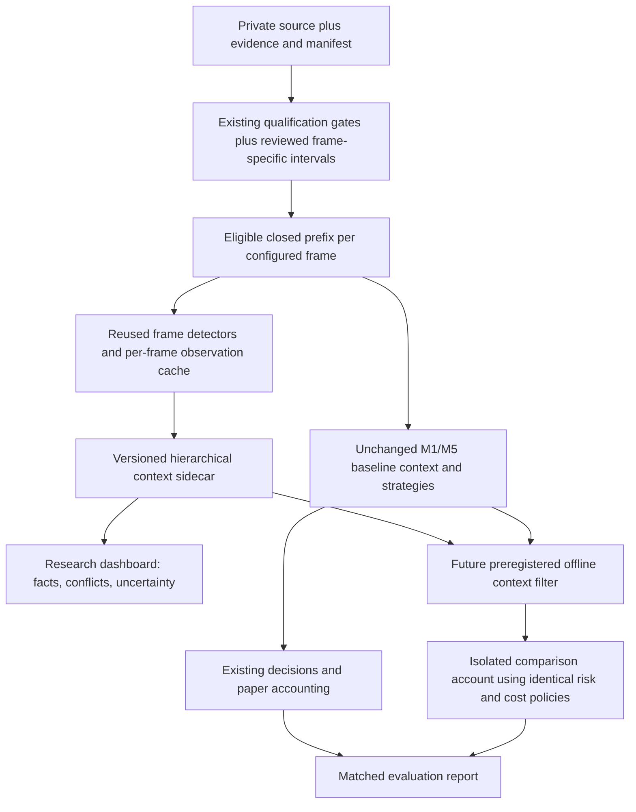

# Configurable multi-timeframe intelligence: proposed architecture v1

Status: DESIGN ONLY. Audited against PR51 commit
`bf5bd478e8298c7e45cffa713a148ab88ce0d2a5` on 27 November 2026.
No new timeframe, data permission, strategy, metric or dashboard feature is
implemented by this document. Current production/research entry points still
support M1/M5 only. Unsupported frames must continue to fail closed.

READ_ONLY_SHADOW; signal=WAIT; execution_allowed=false; Exness BLOCKED;
DATA_NOT_QUALIFIED; historical_validation=PENDING; historical_comparisons=NOT_RUN.
No real or demo orders, credentials, calendar approval or automatic merges.

## Decision and baseline boundary

Build an additive per-frame observation layer and a separate hierarchical context
report. Reuse the existing pure detectors; do not make a second implementation of
structure, zones, momentum or volatility. Do not turn the current M1/M5 aligner
into a majority vote, or silently insert new frames into its confluence sum.

Freeze the existing M1/M5 ContextReport, selected hypothesis, heuristic scores,
strategy predicates, risk/cost/lifecycle policies and journal contracts. The primary
deterministic paper comparison is the existing SR_REJECTION_M1_CONFIRMATION v1
E1 -> E2 -> E3 -> E4/E4.6 chain. Its source-bound synthetic-only restrictions remain.
The two other experimental strategies (M5 trend/M1 confirmation and M1 sweep/
structure change) remain separate research strata, not a newly selected ensemble.
Each study must name its precise baseline; never pool these rule sets as one arm.

The existing deterministic paper workstream proceeds independently. No MTF
milestone is a prerequisite for completing, reviewing or evaluating that baseline.
MTF reports initially have no effect on its decisions or account. A later,
preregistered context-filter experiment is a different, separately versioned arm.

## Audit of current assumptions

Paths below refer to the audited commit. This is an implementation audit, not a
claim that adding names to a registry enables these paths.

| Boundary / source | Current assumption | Required future treatment |
|---|---|---|
| [models.py](../iat/intelligence/models.py) | Literal M1/M5; DURATIONS={60,300}; Alignment has m1_as_of/m5_as_of | Keep v1; introduce a typed frame registry and separate per-frame report map |
| [candles.py](../iat/intelligence/candles.py) | closed_at/prefix add fixed seconds; 5,000-row eligibility cap | Inject a verified interval resolver; retain bounded source validation and legacy defaults |
| [engine.py](../iat/intelligence/engine.py) | analyze/replay/stream accept two named histories; replay clock is M1; Phase7 IDs use window indices | Preserve wrappers; new map-based orchestration reuses frame_report/detectors after eligibility; canonicalize durable identities |
| [multi_timeframe.py](../iat/intelligence/multi_timeframe.py) | Explicit M1/M5 classifications and fresh opposing M1 CHoCH | Leave baseline align unchanged; add role/edge relations in another report |
| [context.py](../iat/intelligence/context.py) | derive iterates frames, but aggregate/context/replay bind M1/M5; evidence freshness is frame-relative | Reuse component derivation after removing interval dependencies behind an adapter; new hierarchical composition, not a forged v1 ContextReport |
| [context_models.py](../iat/intelligence/context_models.py) | One ContextConfig; windows are bars, some tolerances are absolute price distances | Explicit hashed per-frame policies; initially unchanged formulas; no performance-driven silent rescaling |
| [confluence.py](../iat/intelligence/confluence.py) | Weights capped per timeframe/category/direction; opposing CHoCH special case is M1 | Freeze baseline scores; extra correlated frames must not inflate that score by adding buckets |
| [context_evidence.py](../iat/intelligence/context_evidence.py) | Timestamp/content canonical IDs; event identity separate from evidence revisions | Reuse canonical/event identities; namespace new source/interval contracts without rewriting legacy IDs |
| [quality.py](../iat/quality.py) | Only M1/M5; epoch modulo alignment; fixed duration freshness | New explicit interval/finality policy; do not loosen legacy acceptance |
| [sessions.py](../iat/sessions.py) | Fixed-duration grids and whole bars contained in session windows | Not sufficient proof for bars spanning multiple quote sessions, DST or weekly bins |
| [session_v2.py](../iat/session_v2.py) | M1/M5 only, partial-bar classes and 60/300-second branches | Separate reviewed extension; never relabel every non-M1 frame as M5 |
| [mt5_data.py](../iat/mt5_data.py), [live_data.py](../iat/live_data.py) | Allowlisted M1/M5 constants, position1 closed reads | Add explicit supported native mappings only after offline contracts and tests; never infer missing constants |
| [mt5_connection.py](../iat/mt5_connection.py) | Single read-only owner, exposes M1/M5 only | Keep serialization/recovery; no parallel SDK workers per new frame |
| [live_observer.py](../iat/live_observer.py) | 500 M1/100 M5, five-M1 comparison, one combined closed cache/M1 cutoff | Add bounded per-frame scheduling/cache outside the unchanged baseline; no arbitrary history shortening |
| [replay_dataset.py](../iat/replay_dataset.py), [historical_replay.py](../iat/historical_replay.py) | Manifest v1/v2 exact M1/M5 keys; five-to-one OHLC checks | A new manifest contract with independent evidence and lineage per frame; old formats remain strict |
| [strategies.py](../iat/intelligence/strategies.py), [sr_rejection.py](../iat/intelligence/sr_rejection.py), [entry_intelligence.py](../iat/intelligence/entry_intelligence.py) | M5 anchors/M1 confirmations; SR P/T/C and expiry clock in eligible M1 closes | Preserve exact baseline rules and setup IDs; new context cannot redefine an entry |
| [strategy_replay.py](../iat/intelligence/strategy_replay.py), [strategy_dataset_replay.py](../iat/strategy_dataset_replay.py) | M1 evaluation clock, M5/sweep anchor lifecycles, warm-up carry-in | Shared M1 evaluation timestamps; frame-specific warm-up and availability sidecars; unique setup accounting |
| [adaptive.py](../iat/intelligence/adaptive.py), [hypotheses.py](../iat/intelligence/hypotheses.py) | Pair-specific regime, scenario support and conflicts | Keep baseline ranking; new hierarchical interpretation is explainable and separately versioned |
| [reasoning_journal.py](../iat/intelligence/reasoning_journal.py), [journal_policy.py](../iat/intelligence/journal_policy.py) | M1 evidence coverage and 5/15 elapsed-minute first-breach reviews | Preserve those reviews; longer context horizons need another policy, not a relabeled 5/15 result |
| [API adapter](../iat/intelligence/api.py), [main.py](../main.py) | Research requests fetch M1/M5, align to an M1 close; /analyze aliases only 1m/5m | Keep existing request/response rules; a later additive research interface must not make old endpoints accept unimplemented frames |
| [qualification_assistant.py](../iat/qualification_assistant.py), [pilot_preparation.py](../iat/pilot_preparation.py) | Exact native M1/M5 pairing, origins, warm-up and fixed close arithmetic | New per-frame evidence/intake contract, preserving strict independent approval and native/derived distinction |
| [dataset schema](../config/historical-dataset-v2.schema.json), [DecisionLog schema](../config/decision-log-v1.schema.json), [scenario_assessment.py](../iat/intelligence/scenario_assessment.py) | Pair-bound schemas, explicit time keys and strict validation | New sidecar schemas/chronology validation, not extra fields smuggled into old contracts |
| [B.2 runtime](../iat/live_shadow/runtime.py), [tick feed](../iat/live_shadow/feed.py) | Fixed M1/M5 capture and separate strict tick freshness/future checks | No implicit B.2/B.3 journal migration, new service start or tolerance change |
| [quote importer](../iat/strategy_qualification/quotes.py) | File-bound Bid/Ask, strict unique UTC timestamp order and human evidence | Reuse import/evidence work; simultaneous-tick sequencing and an E4 bridge need separate contracts |
| [review_pilot.py](../iat/review_pilot.py) | Blinded M1/M5 packets and frame enums | Version new packets, same cutoff, no higher-frame future candles or IAT conclusions |
| [risk_intelligence.py](../iat/intelligence/risk_intelligence.py) | ATR reference limited to M1/M5 | No automatic H4/D1 risk substitution; context expansion is not risk-model expansion |
| [paper_contracts.py](../iat/intelligence/paper_contracts.py), [protected_paper.py](../iat/intelligence/protected_paper.py) | Authenticated invented Bid/Ask, latency/cost/specification and ordering contracts | Reuse accounting unchanged; OHLC context must never manufacture executable quotes |
| [live_market_view.py](../iat/live_market_view.py), [dashboard](../iat/live_web/index.html) | M1/M5 source-bound presentation and blocked E1/E2/E3/E4 availability | New explicitly labeled research panel/sidecar; no automatic live strategy or paper activation |

## Target data flow

Every box after qualification is still research-only. Historical provenance text,
a healthy MT5 connection or an OHLC match is never qualification approval. The
future historical bridge must invoke actual loader/preflight checks, not relabel
the current synthetic-only E1/E4 interfaces as historical.

## Proposed registry and configuration contract

A future strict versioned registry must separate frame name, source encoding,
interval resolver, provider/feed, symbol, BID/ASK/MID basis, native/derived lineage,
publication/finality/correction evidence, role, required/optional policy and resource
budget. Unknown names, duplicate definitions, cycles, ambiguous anchors, missing
required evidence and unsupported combinations reject the affected experiment.
No unknown frame silently becomes M5, and no tick is treated as an OHLC candle.

| Planned frame | Interval semantics requiring verification | Priority / intended context |
|---|---|---|
| M1, M5 | Preserve existing 60/300-second contracts | Frozen baseline |
| M3, M15, M30 | 180/900/1,800 seconds with explicit provider grid anchor | M15 first; M3/M30 later fixed-frame adapters |
| H1, H4 | 3,600/14,400 nominal seconds; provider anchor and quote-session coverage | Priority intraday / strategic context |
| D1 | Provider trading-day boundaries and IANA zone; DST may change UTC spacing | Priority strategic context after H4 |
| W1 | Verified provider week opening/closing convention and exceptions | Extended strategic context, after D1 |
| MN1 | Actual calendar-month boundaries, leap years and publication policy | Later; never assume a 30-day duration |
| TICK | Sequenced event/receipt timestamps, Bid/Ask and completeness | Separate offline fill/execution-research input; no order capability |

A daily or weekly broker bar is not automatically a UTC-midnight 24-hour or
Monday-to-Monday bin. Even fixed subday frames require verified source anchors.
UTC timestamps describe instants; they do not identify the broker's bar calendar.
The current session engines do not establish these new contracts.

Configuration must declare a finite acyclic role graph and ordered profiles. One
observation can serve more than one labeled role but is not counted twice. Proposed
roles: strategic (H4/D1/W1, later MN1), intraday (H1), setup (M15, optionally M30),
entry timing (M1/M3/M5). These are research roles, not execution permissions. The
baseline's M5 setup/context role remains exactly as implemented. Missing roles in
smaller profiles are NOT_CONFIGURED, not inferred from nonexistent higher frames.
Required-but-unavailable frames are BLOCKED/UNKNOWN, not NOT_CONFIGURED.

No runtime-loadable registry/configuration is added in this documentation PR.
Future schema review must fix these fields and migration rules before code lands.

## Reuse, warm-up and scale

Reuse patterns.recognize; swings.detect; structure.classify; bos_choch.detect;
support_resistance.detect/lifecycle; supply_demand.detect; liquidity.detect;
momentum.measure; volatility.measure. engine.frame_report and context.derive are
orchestrators to adapt, not complete arbitrary-timeframe implementations today:
they and their callees still depend on closed_at/DURATIONS and baseline types.
An interval resolver must reach every close/confirmation timestamp calculation.
Liquidity pools and supply/demand remain OHLC-derived proxies, not observed hidden
orders or independent order-book evidence.

The first extension keeps formulas and baseline configs unchanged. Any per-frame
parameter choice has an explicit version/hash, units and rationale approved before
outcome inspection. Fourteen bars means a different elapsed horizon on H4/D1; do
not silently convert it to fourteen minutes or fit tolerances to improve results.
Absolute zone tolerances and ATR/ROC scale applicability need independent review.

Warm-up is feature-specific: momentum needs roc_period+2 bars; volatility needs
both atr_period+1 and 2*range_period; base/departure needs preceding/base/departure
history; patterns and breakout confirmation have their own windows. Swing
confirmation requires left/right closed support; structure needs two confirmed
highs AND two lows. A bar-count bound cannot guarantee those pivots exist. Flat or
sparse long histories legitimately remain UNKNOWN. Range/ATR source windows and
right-side confirmation must all be complete before the first evaluation use.
Declare actual preceding sessions for every frame; cap memory/history explicitly.
Do not request the same arbitrary 500 bars on every frame, or shorten history to
avoid session gaps. If sufficient warm-up exceeds the resource cap, report blocked.

## Closed, forming, available and final are different

Future normalized bar metadata must retain source opening, verified interval end,
active quotation segments, provider publication/receipt availability, finality and
correction revision. A nominal bar spanning an intraday break can have multiple
quote segments; legitimate closures do not authorize inventing absent candles.
Dated holidays, DST and maintenance coverage must span the entire interval and
warm-up, not just the decision date. Quote availability and permission to open
trades remain different phases, including close-only quotations.

At a frozen research decision time T, use only evidence with verified interval
end <= T AND source availability/confirmation <= T. Unknown availability/finality
fails closed; native position1 is useful acquisition evidence, not independent
proof of historical capture completeness. Never infer finality from file age.
If a future design uses separate market cutoff/decision receipt clocks, both need
an explicit versioned contract; do not change the baseline clock in this expansion.

Example: at 10:07 UTC the H1 bar opened at10:00 is forming and cannot be used.
At11:00 it is still unavailable if the provider confirms/publicizes it at11:00:02.
It first becomes eligible at a later permitted baseline decision cutoff. A pivot
that occurred two H4 bars ago is not known until its right-confirmation bar closes
and is available. Use confirmation/availability, not occurrence, for as-of joins.

Forming previews, if later added, live in a separately labeled display channel;
they never update confirmed structure, zones, evidence scores, strategy predicates
or paper decisions. This plan does not change the existing position0 exclusion.

## Hierarchical interpretation without voting

Compose relations on explicit graph edges, with evidence IDs and temporal scopes.
Do not count bullish frames or assume the highest timeframe is automatically right.
Do not let adding correlated frames increase the legacy confluence score. Intraframe
facts, cross-frame interpretations and resulting assessment must stay separate.
Volatility is a separate dimension: an uptrend and high volatility can coexist.

| Proposed relation | Evidence required before emitting it | What it does not establish |
|---|---|---|
| TREND_ALIGNED | Independently confirmed parent/child structures in the same direction; sufficient history and no material current structural contradiction | Profitability or automatic entry |
| PULLBACK_CANDIDATE | Established parent trend intact, evidence of lower-frame retracement toward an already available level, no confirmed parent reversal | Mere disagreement is not a pullback or an entry |
| REVERSAL_CANDIDATE | Causal opposing structure change against prior direction, cited broken level/confirmation and explicit parent invalidation conditions | A lower-frame CHoCH alone does not confirm a D1 reversal |
| RANGE_CONTEXT | Existing per-frame ranging evidence and its scope; incompatible frames shown separately | Every frame is ranging |
| CONFLICTING_EVIDENCE | Opposing structure/events or incompatible roles at the same cutoff | A majority winner or permission to ignore opposition |
| UNKNOWN / BLOCKED | Missing warm-up, ambiguous intervals/finality, failed quality or required-frame data | A neutral forecast or zero risk |

These are design predicates to formalize and independently review in a later PR,
not new implemented labels. Relations can coexist (e.g. H4 uptrend, M15 pullback
candidate, fresh opposing M1 CHoCH); do not flatten them to one mandatory direction.
A fresh opposing CHoCH must remain contradictory even if aggregate structural
labels match. Preserve ties, alternative scenarios, assumptions, invalidation and
what evidence would change the assessment. No calibrated confidence percentages.

## Evidence identity and computation

Never persist Phase7's window-relative C/P indices as event identities. Reuse
context_evidence's canonical timestamp/content IDs and CHoCH event/revision split.
The new envelope must bind source/feed, basis, interval convention/version,
timeframe, occurrence/confirmation, source revision and configuration. Preserve
legacy IDs/contracts rather than renaming historical evidence in place. Hierarchy
changes create assessment revisions; they do not create another underlying event.
A derived H1 and its constituent M1 bars share lineage; OHLC equality is an internal
aggregation check, not independent confirmation or native-feed validation.

Maintain separate bounded per-frame observation caches. Keys include symbol/feed/
basis, interval/calendar/source revisions, eligible closed-prefix digest, detector
policy hashes and connection generation where applicable. Recompute a frame only
when its eligible closed prefix or dependencies change; tick updates do not rerun
H4/D1 detectors. Availability-driven scheduling must not publish a frame early.
Reevaluate cross-frame joins at each baseline cutoff, including evidence age, new
M1 contradictions and changed session/quality state even when the HTF cache hits.

Corrections, source changes, calendar expiry/updates, disconnection and quality
failures invalidate affected dependencies immediately. Never rewrite an emitted
past assessment; retain source revisions and separate later correction records.
Streaming state must carry prior canonical anchors across windows without counting
them twice. Compare cached/incremental output with full-prefix recomputation before
optimization is accepted. Bound bytes, rows, cache entries, queues and worker time;
unknown/over-budget frames fail closed. Acquire through the existing serialized
MT5 owner; no parallel initialize/read/shutdown workers per timeframe.

## Reports and dashboard integration

Propose MultiFrameContext v1 as an additive research report containing frozen T,
frame/profile/role/config hashes, per-frame quality and warm-up, interval end and
availability, structures/events/zones/liquidity/momentum/volatility, role relations,
canonical support/opposition, conflicts, uncertainty and missing evidence. Include
a reference to the unchanged baseline snapshot/hash, not a fabricated eligible
ContextReport. Preserve DecisionLog v1, Strategy Replay Log v1, reasoning-journal
review policy and protected paper journal v2 contracts; sidecars link by stable IDs.

Missing optional HTF data does not invalidate otherwise valid M1/M5 arm A. It blocks
an arm/policy that requires that frame; that arm cannot silently fall back to A.
Shared source/checksum/qualification failures block every affected arm. Per-frame
uncertainty and formal eligibility must not be hidden by a healthy connection.

A later dashboard may show a frame/role matrix, confirmed close/availability/age,
forming preview labels, hierarchy edges, warm-up, cited conflicts and baseline
comparison. Required/optional/not-configured states stay visible. HTTP only reads
published immutable cached reports, never acquires MT5 data. Live higher-frame
presentation needs a separate reviewed integration PR; live E1/E2/E3/E4, external
AI and execution remain disabled by default and are not authorized by this plan.

Next: [sequenced research PRs](MULTI_TIMEFRAME_IMPLEMENTATION_ROADMAP.md) and
[matched experiment protocol](MULTI_TIMEFRAME_RESEARCH_PROTOCOL.md).
