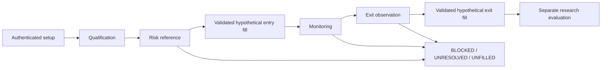

# Proposed E4 Paper Trading architecture — not implemented by E3

E4 would be an explicitly versioned, independently reviewed research model, not a
broker adapter or execution approval. E1/E2/E3 currently establish no fills,
positions, holding durations or performance. All existing safety gates remain.

## Data flow and state contract

Suggested IAT_PAPER_RESEARCH_V1 inputs: frozen authenticated E1 qualification,
original/current E2 and E3 reports, a qualified dataset manifest, exact native bar
and quote source hashes, versioned entry/exit/fill/cost policies, session metadata,
contract/currency evidence, explicit cutoffs and any separately authorized research
exposure assumptions. Policy changes require a new cohort/version, not retroactive
reinterpretation. A research qualification or geometry ratio is never an entry.

Each transition must preserve canonical hypothesis and hypothetical-position
identities, original direction, policy and dataset/configuration hashes, source
quote IDs, occurrence/availability/receipt timestamps, session state, unresolved
reasons and lifecycle events. Distinct touch anchors remain distinct. Repeated
observations must not mint another position/fill. Blocked data cannot advance a
position or manufacture an exit; missing data must remain visible. Freeze original
assessments; attach later outcomes separately. Require transactional state updates,
bounded inventories, explicit resource-limit failures and no silent resets.

## Side-specific fill and cost prerequisites

Long hypothetical entry requires an eligible **Ask**, exit an eligible **Bid**;
short entry Bid, exit Ask. Require same-feed timestamped Bid/Ask with validated UTC
interval/clock/receipt conventions, sequence/duplicate/correction rules, capture
completeness, session eligibility and predeclared freshness/latency assumptions.
The earliest candidate observation follows confirmation availability under a
reviewed entry rule; a confirmation close is not a fill. No tick price, spread,
liquidity or slippage can be inferred from M1/M5 OHLC.

A quote is still not evidence of executable liquidity. A reviewed synthetic fill
model must explicitly distinguish observed quotes from assumed fills, source its
slippage and commission assumptions, preserve unknown values and handle missing/
stale/future quotes or simultaneous timestamps. OHLC target/stop observations do
not select an intrabar order. Any pessimistic/optimistic sensitivity is a labeled
alternative model, never a historical fact.

Verified symbol specification needs evidence dates/provider, broker point, tick
size/value, contract size, profit/account currency, conversion and financing/swap
where applicable. Commission requires units and charging convention; slippage a
versioned model, not a favorable constant. Side-specific Bid/Ask prices already
incorporate spread: **do not add spread again**. Missing costs remain unavailable,
not zero. E3's mechanically valid synthetic declarations are not independently
qualified inputs. A declared evidence hash is not approval or source authenticity.

## Timing and comparisons

Retain EXIT_TIMING_RESEARCH_PROTOCOL.md. Compare 15/30/50/60/90/120 seconds,
structural exits, momentum exits and explicitly versioned fixed-reference R:R
variants on the same entry cohorts with policy choices frozen in advance.
A 50-second duration starts at a **validated hypothetical fill timestamp**. Use the
first eligible quote at/after its deadline, retain observed delay, missing ticks,
staleness and session interruptions. Do not synthesize exact 50-second outcomes
from M1 OHLC or start the timer at candle open/setup detection. E3 runs no timer.

MFE/MAE require complete side-specific mark-to-exit observations between known fill
and exit, with units and costs explicit. Missing intervals imply incomplete
excursions, not zero. Holding duration requires both modeled fills. Hypothetical
P&L, win rate, profit factor, drawdown, entry/exit efficiency and transaction costs
require qualified data plus reviewed fill/cost/exit models and explicit resolved,
unresolved, unfilled and blocked denominators. No such metrics exist in E3.
Use deterministic full/full/prefix replay, frozen warm-up/evaluation boundaries,
matched cohorts and reserved out-of-sample intervals; do not tune on test outcomes.

## Exposure and capital protection — future interface only

A future authorized research model could consider balance/equity, risk per trade,
maximum daily loss/drawdown, consecutive losses, open exposure, concentration,
session/volatility restrictions and emergency stop conditions. No private account
balance/equity is read without separate authorization. The operator's stated
**0.1 lot** is a preference for future controlled research, not a recommendation,
validated size or appropriate exposure for any account. No executable sizing,
margin or capital exposure is calculated from unverified specifications. E3's
position_size, capital_at_risk and margin_required remain null.

Future limits should be independently selected/versioned with evidence, currency,
units, scope and missing-input behavior. A risk-model label cannot approve an
order or relax source/calendar qualification. Do not reuse E3 reference distance
as monetary position risk without a validated fill, compatible basis and contract.
Actual broker permissions and execution adapters remain outside this milestone.

## Historical bridge requirements

Before any real-data comparison: a legally permitted private export with native
same-feed M1/M5 consistency, exact original/normalized SHA-256 manifests, declared
feed/price basis, UTC opening conventions, dated session/holiday/maintenance
coverage, bar finality/corrections and independent qualification. Derived M5 is
internal aggregation evidence only. Reuse the existing loader/preflight and SR
manifest integration; preserve warm-up carry-in, evaluation coverage/denominators
and outcome observation cutoff. Private raw-source replay is necessary for portable
verification; no source label or report checksum qualifies data.

Add qualified timestamped Bid/Ask capture, specification/currency/cost evidence,
correction policy and independent approval before fills or timing comparisons.
Keep raw broker data and full real-data journals private. No qualified export was
available here, no bridge was implemented and no historical strategy comparison
was run. Historical validation stays PENDING; comparisons NOT_RUN.

## E4 first milestone and acceptance

Start with independently invented synthetic quote sequences and one reviewed
side-specific fill/identity contract. Test long/short asymmetry, confirmation and
quote availability, same-time ordering, fresh/stale/future ticks, missing ticks,
clock changes, spreads, corrections, session breaks, partial cost evidence,
currency/contract mismatches, duplicate prevention, blocked/unfilled states,
transaction rollback, prefixes/future append and immutable originals. Introduce
no order API, executable size or live strategy activation. Expand to one exit-fill
model only after independent review; full paper-position/cohort performance is a
later milestone. E3 does not implement this lifecycle.

WAIT; execution_allowed=false; Exness BLOCKED; DATA_NOT_QUALIFIED;
historical_validation=PENDING; historical_comparisons=NOT_RUN. No account/credential
access, broker order, permission/calendar change, AI activation or PR merge.
