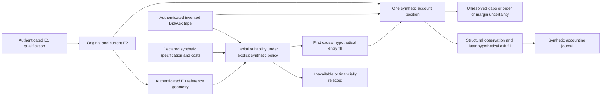

# E4 paper trading and capital architecture

The current milestone is a bounded **synthetic-only** one-position linear-USD
research account. It is not the complete future Paper Trading Engine or a live
adapter. See PAPER_TRADING_V1.md, CAPITAL_INTELLIGENCE_V1.md,
SYNTHETIC_FILL_MODEL_V1.md and RISK_INTELLIGENCE_V1_INDEPENDENT_REVIEW.md for exact
contracts, tests, limits, assumptions and deferred work.

The target research starting capital is USD50; primaryM1/contextM5. WAIT is valid.
Neither0.1lot nor50seconds is mandatory. There is no daily profit/pip target.
Evidence strength is not a confidence probability; market qualification and
capital affordability are separate. A step-rounded minimum lot can be unaffordable;
do not move the structural reference or raise leverage/risk to make it fit.

Implemented sequence: E3 automated contract review → E4.1 typed authenticated
synthetic quote/fill → E4.2 account/capital → E4.3 one-position E2 structural
lifecycle → E4.4 versioned accounting journal → E4.5 blocked live availability UI
and automated adversarial review. External independent approval is still pending.
There are no real-feed collectors, historical importers, broker calls or live
paper strategy in this implementation. E1/E2/E3 and DecisionLog contracts remain.

Long entryAsk/exitBid; short entryBid/exitAsk. Explicit latency/slippage/costs,
freshness/analysis-age/gap policy, source sequence and session permissions are
required. Quote spread is already in side prices and is never deducted again.
A candle contact/close is only an observation, never an executable price. E2
frozen targets/invalidation/ambiguity remain unchanged. Protective-stop activation
and hypothetical fills are separate; this milestone does not submit or model a
protective stop at the structural threshold. It can model the first eligible quote
after a known structural close, including adverse gap-through. Loss estimates are
not guarantees. Unknown data/costs/specs never become zeros.

## Extension contracts, not enabled exits

| Exit research policy | Current status | Required next evidence/model |
| --- | --- | --- |
| E2 structural target | Implemented synthetic observation then later quote | Frozen original E2 reference and exact observation availability |
| E2 structural invalidation | Implemented synthetic observation then later quote | Original strict eligible-close predicate; no guaranteed stop fill |
| E2 opposing structure | Implemented when explicitly selected | Confirmed canonical opposing event, source availability |
| Protective stop/gap activation | NOT_IMPLEMENTED | Independently reviewed quote-side activation, order and adverse-fill rules |
| Momentum deterioration | NOT_IMPLEMENTED | Authenticated existing evidence and preregistered invalidation criteria |
| Trailing | NOT_IMPLEMENTED | Causal update policy, immutable previous levels and missing-tick handling |
| Timer | NOT_IMPLEMENTED, optional | Hypothetical fill timestamp and sufficiently granular eligible Bid/Ask |
| TP2/TP3/partial exits | NOT_IMPLEMENTED | Original causally eligible references plus valid min/step volumes |
| Margin liquidation | UNRESOLVED when encountered | Reviewed method-specific call/stop-out ordering and costs |

Timer comparisons may include15/30/50/60/90/120seconds, not a default exit. The
existing EXIT_TIMING_RESEARCH_PROTOCOL.md remains a future matched-cohort protocol.
The first eligible quote at/after a selected deadline must retain observed delay,
missing/stale ticks and session interruptions. Exact50-second outcomes cannot come
from M1OHLC. Do not retrospectively choose the most profitable exit or treat
unresolved same-candle events as a win.

A future multi-target policy must freeze valid opposing references at original
qualification. No valid extra reference means unavailableTP2/TP3, not invented
prices. Partial exits need broker minimum/step volume; do not split0.01 into
unsupported smaller sizes. This milestone rejects all partial exits.

## Capital, costs and account extensions

Only declared synthetic linear notional/leverage with USD account/profit/margin
and conversion1 is implemented. A versioned broker-spec contract retains min/max/
step/tick/contract/currency/margin/stop/freeze/cost/call/stop-out/session/source/
effectivity fields. Missing/unsupported values block corresponding calculations.
The future read-only specification collection plan is metadata preparation only;
MT5 symbol metadata cannot certify dated sessions, fees or bar finality.

Account tracking preserves fees, balance/equity/free margin, hypothetical P&L,
peak equity and drawdown. No hidden loss clipping, deposits, reset, martingale,
size escalation or replenishment. Policies explicitly limit per-position and
aggregate risk, UTC daily realized loss, maximum historical drawdown, reserve,
concurrent positions, consecutive losses and estimated costs. Cash events are
explicit and exclude net-return comparisons. One open position; unresolved gaps
lock new positions. No private balances are read or assumed.

## Historical bridge and independent qualification

Before real-data evaluation: authorized private native same-feedM1/M5 and eligible
Bid/Ask, original/normalized hashes/manifests, price basis, UTC occurrence/receipt
conventions, dated session/holiday/maintenance coverage, capture completeness,
bar finality/corrections, contract/currency/cost evidence and independent sign-off.
Weekly symbol metadata does not prove holiday exceptions. DerivedM5 remains
internal aggregation evidence only. Reuse existing loader/preflight, warm-up and
evaluation boundaries; no caller-supplied provenance label can qualify an export.
Portable raw-source replay and explicit observation cutoffs remain necessary.

Then freeze policies, risk alternatives0.5/1/2%, matched entry cohorts and reserved
out-of-sample intervals. Distinguish capital survival/suitability from strategy
profitability. Preserve unresolved/unfilled/blocked denominators and reviewer
disagreement; synthetic accounting is not historical strategy performance.
Future calibration needs real out-of-sample reliability evidence before any
probability or safety label. There are no invented confidence percentages here.

Live integration awaits formal live provenance, reviewed session/integrity work,
qualified sources, costs/specs and separate authorization. The current dashboard
shows only research configurationUSD50 and BLOCKED/NOT_RUN/PENDING availability;
no synthetic balance/P&L/size is combined with live observations. No B.2/B.3 service
or external AI is started by this work.

WAIT; execution_allowed=false; Exness BLOCKED; DATA_NOT_QUALIFIED;
historical_validation=PENDING; historical_comparisons=NOT_RUN. No actual/demo
orders, execution API, credential/account read, broker approval or PR merge.

## E4.6 versioned protection extension

`ProtectedPaperAccount` adds a distinct v2 journal, explicit v1 stop/liquidation
policies, source-authenticated receipt-by-receipt replay and separate cutoff
reviews. It reuses unchanged v1 capital/settlement math via transaction hooks;
ordinary v1 payloads remain golden-tested. All consumed quote prefixes are
privately authenticated in both producers; no serialized hash alone authorizes
history. See [protective contract](PROTECTIVE_STOP_INTELLIGENCE_V1.md),
[liquidation contract](SYNTHETIC_LIQUIDATION_V1.md) and
[independent automated review](PAPER_TRADING_V1_INDEPENDENT_REVIEW.md).
The live dashboard adds blocked availability text only. No live evaluator,
qualified historical bridge or execution dependency is introduced.
