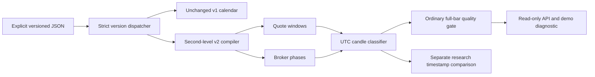

# Session Engine v2

AI Reasons. Code Protects. Evidence Validates. Evolution Improves.

This engine handles market-session knowledge and data integrity only. Broker
permissions are informational. `iat_execution_allowed=false`, API
`execution_allowed=false`, and signal WAIT remain fixed. No order/login/account
switching/execution-enable interface is added.

## Architecture and compatibility

`iat/session_config.py` dispatches only explicit integer version 2 to
`iat/session_v2_config.py`. v1 loading, minute boundaries, assurance markers,
coverage, global timeframe-alignment policy and API fields retain their original
semantics. Unsupported versions/types fail closed. No previous profile bytes or
verification states are rewritten. The existing Exness v1 candidate stays blocked.

The v2 compiler returns immutable `SessionCalendarV2`/`Phase` objects. Generic
engine code contains no Exness hours or asset-specific logic. UTC phase/quote
indexes support bounded candle classification without scanning the whole year
for each bar. Raw source references are private configuration inputs, not API or
shareable report fields.

## JSON contract

The complete structural schema is `config/session-calendar-v2.schema.json`.
`config/examples/session-v2.synthetic.json` is a complete, loadable **synthetic
fixture**, not broker configuration. Do not use it as evidence of actual hours.

All top-level fields are required and unknown fields are rejected:

| Field | Semantics |
| --- | --- |
| `version` | Exactly integer 2; no boolean/string/float aliases. |
| `symbol`, `timezone` | Exact symbol and explicit IANA zone. No broker alias/zone inference. |
| `coverage` | Local ISO dates, start-inclusive/end-exclusive at midnight; 1–366 days. |
| `weekdays` | All seven keys; each has independent `quotes` and `phases` arrays. |
| `verification` | Four boolean declarations, aware `expires_at`, and nonempty dated provenance. |
| `candle_finality` | Explicit full-bar provider policy and its verified declaration. |
| `holidays`, `exceptions`, `closures`, `maintenance` | Dated, bounded overrides with defined precedence. |
| `assurance_holds` | Explicit known blocking reasons; there is no approve/force flag. |

Quote windows contain `open`, `close` as strict HH:MM:SS and explicit integer
`close_day_offset` 0 or 1. Phases add `state`. Zero requires a later close on the
same date; one permits overnight close at/before the opening clock time, at most
one local day. Midnight-to-midnight is 00:00:00/00:00:00 with offset 1. A day has
at most 32 intervals per channel. Adjacent quote windows merge; overlaps within
one channel are rejected even if states match.

Verification requires `quote_schedule_verified`, `trade_schedule_verified`,
`holidays_verified`, `maintenance_verified`, `expires_at`, and `provenance`.
Provenance entries have unique safe `id`, kind PUBLISHED/LOCAL_OBSERVATION/
SYNTHETIC_TEST, a private `reference`, and aware second-level `captured_at`.
Expiration must lie within coverage. Future-captured evidence cannot establish a
current runtime request. Sources and flags are **operator declarations**, not
cryptographic authentication or automatic broker certification. Missing evidence
creates assurance holds; schema validity or green tests never set flags true.

The only ordinary finality contract currently supported is
`{"policy":"MT5_POSITION_1_ELAPSED","verified":true}`. It must be independently
established for the actual full-bar provider. A false declaration blocks runtime
use. It does not establish partial-session candle finality. The provider requests
position 1, checks scheduled elapsed time, then performs all existing OHLC,
chronology, count, freshness and clock checks. Pure OHLC assessment without an
explicit observed-finality fact rejects v2 ordinary inputs.

## Phase permissions and availability

| State | Quote availability | Broker opens | Broker closes | IAT executes |
| --- | --- | --- | --- | --- |
| FULL_TRADING | Requires covering quote windows | true | true | false |
| CLOSE_ONLY | Requires covering quote windows | false | true | false |
| QUOTE_ONLY | Requires covering quote windows | false | false | false |
| CLOSED | Must not intersect quote windows | false | false | false |
| UNKNOWN | Established separately or unknown | null | null | false |

An independently known quote schedule can remain informationally known while
trade permissions are unknown. A quote never implies permission to open/close.
A complete verified trade schedule must cover every covered instant with known
phases; uncovered gaps are UNKNOWN, never silently CLOSED or QUOTE_ONLY.
Contradictory FULL/CLOSE_ONLY/QUOTE_ONLY-without-quotes or CLOSED-with-quotes
intervals are rejected. Expired/unknown public state masks current permissions.

Precedence is explicit and tested:

1. Weekly intervals form the base; overlapping base definitions fail.
2. Dated `exceptions` replace the entire civil date (including incoming carry),
   plus their explicitly extended overnight intervals. Exceptions are applied in
   date order; a later date wins over earlier overnight carry.
3. Holidays close the entire civil date, including overnight carry. A holiday
   and exception on the same date are contradictory and rejected.
4. Exceptional `closures` subtract quote availability and install CLOSED phases.
5. `maintenance` applies last, with highest closure precedence.

Overlapping closure/maintenance cuts are a union with deterministic origins;
there is no automatic repair of overlapping raw weekly phases. All cuts require
local YYYY-MM-DDTHH:MM:SS timestamps inside coverage. Holidays/closures never
create OHLC prices. Local boundaries are converted to UTC only when unique;
nonexistent spring-forward or ambiguous fall-back boundaries are rejected.
Continuous sessions spanning unique boundaries naturally contain 23/25 UTC hours.

## Candle boundary and finality policy

A scheduled candle interval is `[UTC open, open + 60/300 seconds)`. The classifier
separately returns that interval, configured quote-covered portions, phase
states, verification status and broker-finality knowledge. It never invents the
actual last tick, partial close price or exact finalized partial close time.

| Class | Geometry |
| --- | --- |
| FULL_SESSION_BAR | Quotes cover the whole scheduled interval. This does not imply full broker trading permission. |
| PARTIAL_SESSION_OPEN | One quote portion begins inside the bar and reaches its end. |
| PARTIAL_SESSION_CLOSE | One quote portion starts at the bar open and ends inside. |
| CROSSES_SESSION_BREAK | Multiple quote portions, or a bounded quote island lying inside both bar edges. |
| OUTSIDE_SESSION | Verified covered interval has no quote portion. |
| UNKNOWN_SESSION | Coverage or required schedule/phase knowledge cannot be established. |

For a 21:58 quote close, M5 21:55–22:00 has only a configured 180-second quote
portion and is PARTIAL_SESSION_CLOSE. Neither a plausible OHLC range nor elapsed
22:00 establishes an actual finalized partial candle. A Sunday 23:01 quote start
makes M5 23:00–23:05 partial; M1 23:01–23:02 has full **quote geometry**, but its
broker phase/verification must still be assessed independently.

`research=true` exposes nominal geometry even for an unverified candidate; it
keeps `schedule_verified=false` and cannot make data strategy-eligible. Unknown
out-of-coverage quote duration is null, not an invented zero. Ordinary eligibility
requires full quote coverage, FULL_TRADING throughout, verified declarations,
observed full-bar finality, a valid explicit `as_of`, nonfuture evidence, unexpired
coverage and a currently FULL_TRADING phase. Without as-of context eligibility is
false. IAT execution remains false even when ordinary data eligibility is true.

No partial/restricted/unknown bar is silently dropped to make an ordinary request
pass. The whole ordinary data request fails instead. There is no permissive
partial-bar policy in this phase. Ordinary missing/freshness checks expect only
full FULL_TRADING slots; research separately checks all quote-overlapping slots
and distinguishes missing full from missing partial observations. M1/M5 are
assessed independently. v2 permits off-grid broker boundaries and classifies
individual bars; v1's conservative global alignment rule is unchanged.

## Integration and diagnostics

The existing MT5 validated-list API remains available; snapshots additionally
carry existing quality diagnostics. New reason codes include
PARTIAL_SESSION_CANDLE, SESSION_PHASE_UNKNOWN, CALENDAR_COVERAGE_UNVERIFIED,
UNEXPECTED_MISSING_BARS, PHASE_CONFLICT, TIMEZONE_AMBIGUOUS,
TIMEZONE_NONEXISTENT, CALENDAR_EXPIRED, CANDLE_FINALITY_UNCERTAIN and
BROKER_PHASE_RESTRICTED. Existing stale/duplicate/out-of-order/OHLC/unclosed/
misalignment/backward-clock checks remain active.

`GET /analyze` preserves existing symbol/timeframe/signal/reasoning/quality fields
and aliases. v2 adds `session_v2` with evaluated-at UTC, coverage, expiry, latest
source date, canonical-JSON SHA-256, source count/kinds, blocking reasons, and
informational permissions. Successful v2 responses also classify the last bar.
No raw provenance references/IDs, account fields or server details are added.
These declarations/fingerprints aid reproducibility, not source authentication.
Failures return WAIT, execution false and explainable 400/503 responses.

The demo diagnostic preserves its existing safety gates and report layout, with
optional redacted `session_v2` state. A blocked v2 profile stops before MT5 import
or initialization. Source/proof holds are not cleared by connecting to a demo
account. Existing evidence writing still reserves FAIL before terminal access
and publishes after shutdown. The research report uses an explicit separate
strict validator and can additionally report BLOCKED.

## Exness candidate and broker metadata

`config/profiles/exness-xauusd-v2.candidate.json` preserves the supplied screenshot
quote boundaries and remains BLOCKED. Its sidecar records raw-file checksum,
source limitations and outstanding requirements. The old v1 source/review pair
is unchanged. Coverage remains 2026-11-06 through exclusive 2026-11-16 UTC; no
automatic renewal or guessed holiday/maintenance interval is introduced.

Sources rechecked on 2026-11-12:
[Exness MetaTrader timezone](https://get.exness.help/hc/en-us/articles/360014390760-What-is-the-default-timezone-set-for-MetaTrader)
and [November US DST notice](https://get.exness.help/hc/en-us/articles/31342732737180-Trading-Hours-Update-End-of-US-Daylight-Saving-Time-01-Nov-2026).
The general GMT+0 basis is supported; this does not independently test the local
connection. The dated notice's ordinary XAUUSD row, not XAUUSD 247, provides
close-only 23:00:30–23:02 weekdays and 23:01:30–23:05 Sunday. Local applicability
and the screenshot's minute precision remain unresolved.

The screenshot quotes begin 30 seconds earlier than the notice's close-only
phase. Those first 30 seconds are explicitly UNKNOWN in the candidate, rather
than falsely declaring ordinary trading, quote-only permission or a verified
closure. The public notice's closed-until boundary is retained in sidecar notes;
no contradictory source is silently overwritten. Unknown holidays, maintenance,
quote/trade applicability and finality all remain explicit holds.

Standard Python MT5 has no assumed phase API. Existing weekly/datetime-window
metadata cannot establish separate quote/trade permissions and returns
BROKER_PHASE_METADATA_UNVERIFIED. An explicitly supported reviewed adapter/file
may provide `version:2`, `kind:"PHASES_V2"`, exact private `symbol`, aware
`collected_at_utc`, and a full v2 `calendar`. Coverage must enclose the comparison;
phase evidence must be current, complete and not future-captured. Only finality
uncertainty may be irrelevant to a pure session metadata comparison. Quote and
per-state interval differences are reported; mismatches fail. No such broker
bridge is automatically installed or claimed native. Metadata matching never
sets IAT execution permission or broker-certification flags.

## Migration from v1

Keep the existing file and behavior. Create a separate explicitly version-2 file;
represent exact seconds and independent channels, review overlay semantics, and
start all unverified declarations false. v1 source timestamps are not proof of
v2 phase/holiday/finality verification. Supply dated provenance and an explicit
expiry. Review partial-bar behavior against actual local demo data before
considering ordinary data eligibility. Do not merely append `:00`, copy true
flags from an example, remove holds or round boundaries to obtain PASS.

The bundled synthetic example is solely a compiler/test illustration. Research
always warns on synthetic provenance, even if it is combined with native quotes.
No tests approve the Exness candidate or establish actual broker/terminal success.
See [local research procedure](SESSION_V2_LOCAL_VALIDATION.md) for exact steps,
report semantics, limits and conditions required before a profile can unblock.

## Automated validation

The complete suite contains 251 tests (195 inherited, 56 added), passing locally
on Python 3.11.9 and 3.12.14. GitHub Actions runs the complete suite on Linux and
Windows with Python 3.11.9 and 3.12, including Windows runner fail-closed smoke
checks. These are offline/mocked software checks, not actual-terminal evidence.

## Market Intelligence v1

See [Phase 7 intelligence](MARKET_INTELLIGENCE_V1.md) for the additive
read-only research endpoint, causal swing/break definitions and offline replay.
Existing session/data-quality gates and execution restrictions remain enforced.
